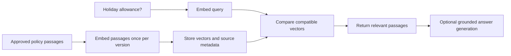

An ExampleCo employee searches for "holiday allowance." The policy document uses the phrase "annual leave entitlement," so a simple exact-phrase search finds nothing. Another employee searches for policy `LV-2026-A`; this time, the exact identifier matters more than a loosely related paragraph.

**Semantic search matches meaning. Keyword search matches words and identifiers. A useful search system often needs both.** Embeddings make semantic search possible, but they do not prove that the matched text answers the question.

## What Is an Embedding?

An **embedding** is a numerical representation of an input. For text, an embedding model maps a passage or query to a fixed-length list of numbers called a **vector**.

```text
Illustrative only:
"annual leave entitlement" -> [0.8, 0.6]
"holiday allowance"        -> [0.9, 0.4]
"expense reimbursement"    -> [-0.4, 0.9]
```

Real text embeddings commonly have hundreds or thousands of dimensions. The two-dimensional example is only for intuition; its numbers are hand-picked and do not come from a trained model.

Nearby vectors can represent related concepts because the model was trained to place useful relationships into the space. The meaning of an individual coordinate is generally not something like "holiday" or "finance."

## Two Models, Two Responsibilities

| Component | Input | Output | Responsibility |
|-----------|-------|--------|----------------|
| Embedding model | Query or document passage | Vector | Represent text for comparison |
| Search system | Query vector and indexed vectors | Ranked passage IDs | Find likely relevant evidence |
| Generative model | Question and selected evidence | Answer text | Explain the evidence |

An embedding model does not normally write the final answer. A generative model does not automatically search your document collection. Keep these steps separate while learning them.



## Similarity: A Small Worked Example

**Cosine similarity** compares the direction of two vectors:

```text
cosine(a, b) = dot(a, b) / (length(a) * length(b))
```

For these hand-made vectors:

```text
query q = [1, 0]
leave p = [0.8, 0.6]
travel t = [0, 1]

length(q) = 1
length(p) = sqrt(0.64 + 0.36) = 1
length(t) = 1

cosine(q, p) = 0.8
cosine(q, t) = 0
```

The leave passage ranks higher in this toy space. **A score of 0.8 does not mean an 80% chance that it answers the question correctly.**

Dot product and Euclidean distance are other comparison methods. For unit-normalized vectors, dot product equals cosine similarity; rankings by squared Euclidean distance are equivalent because `distance_squared = 2 - 2 * cosine`. Without normalization, these relationships do not generally hold.

## Start With Exact Search

You do not need a dedicated vector database to understand retrieval. Start with a few passages and compare the query with every stored vector.

```text
PSEUDOCODE
require_nonempty_query(question)
allowed = authorize_and_load_passages(user)
query_vector = embedding_model.embed_query(question)
require_expected_dimension_and_finite_values(query_vector)

scored = []
for passage in allowed:
    require_matching_embedding_contract(passage, embedding_model)
    if length(query_vector) == 0 or length(passage.vector) == 0:
        fail("Zero-length vector cannot be compared with cosine similarity")
    score = cosine(query_vector, passage.vector)
    scored.append((passage.source_id, score))

return highest_scoring(scored, limit=3)
```

Here, `length(vector)` means its Euclidean norm, not the number of coordinates. A production embedding service should be checked for invalid or unexpected vectors before indexing.

For `N` passages of dimension `d`, a full scan does roughly `N * d` comparison work. This is an excellent baseline for a small collection and for evaluating the accuracy of approximate indexes later.

## The Embedding Contract Must Match

Compatible vectors require more than equal dimension.

Record:

- Model family and exact embedding version.
- Dimension and normalization behavior.
- Required document/query prefixes or task settings.
- Text preparation and chunking version.
- Distance metric expected by the model.

Some models use different query and document encoders or task prefixes. That can be intentional: the pair must be trained or specified to work together. Two unrelated models returning 768 numbers do not automatically share a meaningful coordinate system.

Changing the embedding model usually requires re-embedding the corpus. Build a new versioned index, test it, and switch queries to the matching version; do not mix spaces in one search.

## Similarity Is Not Truth or Applicability

Consider two passages:

```text
A: Region A full-time employees receive 20 days.
B: Region B full-time employees receive 30 days.
```

Both are semantically similar to "How much annual leave do I get?" The right answer depends on employee context.

Likewise, "employees are eligible" and "employees are not eligible" share many words and concepts. Embeddings can place them close together despite their opposite policy meaning.

Use explicit metadata and business rules for:

- Tenant and document permissions.
- Active policy version and effective date.
- Region and employment type where applicable.
- Exact policy identifiers.

Similarity ranks candidates. It must not grant access or decide that a claim is true.

## Keyword Search Still Matters

| Query | Semantic strength | Keyword strength |
|-------|-------------------|------------------|
| "holiday allowance" | Matches "annual leave entitlement" | May miss synonyms |
| `LV-2026-A` | May blur similar identifiers | Exact code match |
| "not eligible for carryover" | Finds related carryover text | Can preserve important literal terms |
| An employee name | Can return related but wrong names | Exact or normalized name match |

The keyword side of a production assistant is usually **BM25**, not a raw substring scan. **Hybrid search** combines BM25 and embedding ranks. Do not add those scores: they are different scales, not probabilities. Rank-based fusion, and the later **cross-encoder** that rescores a shortlist, are covered in [RAG ingestion and retrieval]({}). The embedding model itself is the **bi-encoder**: passage vectors are computed once and reused.

## Choosing a Model and a Threshold

Build a small evaluation set containing:

- Paraphrases with relevant matches.
- Similar-looking but irrelevant passages.
- Exact IDs and unusual terms.
- Opposite statements and exceptions.
- Multiple languages that the product supports.

Measure whether the required evidence appears among the top candidates. A threshold that works with one embedding model or dataset may fail after an upgrade.

There is no universal similarity score meaning "safe to answer." A top result can still be irrelevant when every passage in the collection is irrelevant.

## Privacy and Lifecycle

Embeddings are derived from source content, not guaranteed anonymized versions of it. Protect vector storage, metadata, query logs, and the original text.

When a document is deleted or access is revoked, future retrieval must stop returning it. Cached search results and answers must follow the same rules. See [GenAI safety]({}).

## Trade-offs

| Approach | Benefit | Limitation |
|----------|---------|------------|
| Keyword search | Strong exact-term baseline | Can miss semantic paraphrases |
| Embedding search | Finds related meaning | Can blur identifiers, negation, and applicability |
| Hybrid retrieval | Combines complementary signals | More tuning and evaluation |
| Exact vector scan | Simple, accurate baseline | Work grows with corpus size |
| Larger embeddings | May improve task representation | More storage and comparison cost; not guaranteed quality |

## Test Your Understanding

Try answering before expanding. Explain the missing assumption, not just the vocabulary.


Not without a separately validated calibration model. Cosine measures a geometric relationship in an embedding space. It does not directly measure factual support, applicability, or probability of correctness.



Equal shape is insufficient. Their coordinate systems, training, normalization, and query/document contracts can differ. Use a documented compatible pair and version the index accordingly.



They discuss the same topic and share most language. Semantic proximity need not preserve logical opposition. Retrieve candidates, then inspect the actual wording and applicable policy conditions.



Not necessarily. Every finite candidate set has a top result even when none is relevant. Evaluate relevance and evidence sufficiency rather than assuming rank one means answerable.



An exact scan is simpler and provides a useful correctness baseline. An approximate index adds tuning and recall trade-offs that may offer no practical benefit at that size.



Each vector's norm is one, so the denominator in the cosine formula is one. Without normalization, larger magnitudes can change dot-product rankings.



Usually not. Queries and stored passages must share a compatible representation. Re-embed into a new index and evaluate your own policies before switching traffic.



The vector supports comparison, not exact source reconstruction or trustworthy citation. You need the actual text and metadata to generate, verify, and display evidence.



No. Authorization is a deterministic application responsibility. A highly relevant document can still be forbidden to the caller.



Use keyword or structured identifier matching alongside semantic retrieval. Embeddings are not a replacement for exact constraints on IDs.



No. Quality depends on model training, task alignment, text preparation, and evaluation data. Higher dimensions also increase storage and comparison cost.



Yes. Some models are designed with asymmetric query/document formats or encoders. Follow the documented pairing rather than forcing identical formatting.



It compresses many topics into one representation and may exceed model input limits or dilute a small section. Passage-level embeddings make localized evidence easier to retrieve.



No. It is still derived from potentially sensitive information and may enable inference or linkage. Apply access, retention, and logging controls to vectors as well as text.



Freshness. Semantic relevance cannot establish which version is active. Maintain explicit source versions and effective-date rules.



The embedded text changes. A heading or exception can move into another chunk, changing both its representation and whether it is retrieved with the rule it qualifies.



Not generally. Their scales and directions differ, and equivalence requires specific normalization conditions. Tune thresholds using the actual metric and dataset.



No. Validate the query and surface a clear input error. A meaningless vector lookup can produce an apparently successful but irrelevant answer.



The scores may be on unrelated scales. One signal can dominate arbitrarily. Use calibrated normalization or a tested rank-fusion method.



A retrieval test checks whether relevant permitted evidence appears in the candidate set. A generation test checks whether an answer correctly uses that evidence. Separating them identifies which component needs improvement.

