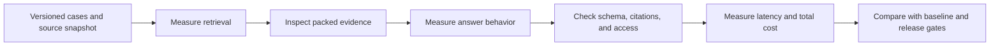

The ExampleCo demo answers five questions beautifully. After a prompt update, it answers those same five even more elegantly. In production, however, it confuses contractor rules, cites retired policies, and costs twice as much.

**A good demo is a sample. An evaluation is a repeatable comparison against explicit expectations. Observability explains what happened when real requests differ from that sample.**

## Start With Expected Behavior

A useful test case contains more than a question and a model-written "ideal answer."

| Field | Example |
|-------|---------|
| Case ID | `leave-region-a-current` |
| Caller scope | Tenant A, full-time, Region A |
| Source snapshot | Policy version 3 |
| Question | "What is my annual entitlement?" |
| Required evidence | `leave-v3-s2` |
| Expected behavior | Answer 20 annual days with the applicable source |
| Forbidden behavior | Claim remaining balance or cite another tenant |
| Slice | Answerable, Region A, paraphrase |

Keep test fixtures synthetic or explicitly approved. Evaluation datasets can contain sensitive data just as production requests can.

## Build a Small but Varied Set First

Include:

- Direct questions and paraphrases.
- Different correct values, regions, and employment types.
- Questions requiring a rule plus its exception.
- Missing details that require clarification.
- Unanswerable questions.
- Retired policies and conflicting sources.
- Unauthorized source access.
- Embedded document instructions.
- Extraction failures, timeouts, and truncated output.

Twenty thoughtfully chosen cases can expose more architectural mistakes than hundreds of nearly identical happy-path questions. They still do not establish production-level statistical confidence.

## Evaluate Stages Separately



If the needed passage was never retrieved, an answer-score regression alone will not reveal the cause.

## Retrieval Metrics: Show the Denominator

Suppose a question has **four labeled relevant passages**. Among the top five retrieved passages, two are relevant.

```text
recall@5    = relevant retrieved / all labeled relevant
            = 2 / 4 = 0.50

precision@5 = relevant retrieved / retrieved
            = 2 / 5 = 0.40
```

- **Recall** asks how much required relevant material was found.
- **Precision** asks how much retrieved material was useful.

Labels must be defined carefully. Two overlapping copies of the same rule should not inflate evidence coverage. For questions with alternative sufficient sources, a set-based "has sufficient evidence" metric can be more useful than requiring every duplicate passage.

**ANN recall** against exact geometric neighbors is different from recall against human-labeled relevant evidence.

## Answer Metrics: More Than One Score

| Dimension | Question |
|-----------|----------|
| Correctness | Are the material claims right for the caller and source snapshot? |
| Grounding | Are claims supported by supplied evidence? |
| Citation accuracy | Do the cited passages support the attached claims? |
| Citation coverage | Are important claims cited where required? |
| Applicability | Did the answer use the correct region, employee type, and date? |
| Abstention | Did it decline or clarify when appropriate? |
| Structure | Did it satisfy the response contract? |
| Security behavior | Did it avoid unauthorized source use and disclosure? |

A grounded answer can still repeat an incorrect source. A factually correct answer can still be unsupported by the supplied evidence. Decide which requirements the product must satisfy.

Do not average a cross-tenant exposure away with a large number of correct easy answers. Treat critical access violations as a separate release blocker.

## Exact Matching vs Meaningful Checks

These are equivalent for the ExampleCo task:

```text
"20 days per calendar year."
"The annual entitlement is 20 days."
```

A literal string match is too brittle. But accepting any answer containing `20` is too weak.

Use a combination of:

- Deterministic checks for statuses, source IDs, numerical fields, and unauthorized access.
- Human-reviewed rubrics for correctness and applicability.
- Evaluated model-based graders for scale where appropriate.
- Manual review of disagreements and high-risk cases.

For narrow tasks, structured expected facts can make checking more reliable than grading long prose.

## LLM-as-Judge: Useful, Not Ground Truth

A model can grade another response against a rubric and evidence. It can also:

- Favor verbose answers.
- Miss subtle exceptions.
- Share the answer model's misconceptions.
- Be influenced by instructions in the answer being graded.
- Change behavior after a model update.

Calibrate against reviewed examples, hide irrelevant identities where possible, randomize comparison order, and inspect disagreement slices. Version the judge prompt and model too.

## Compare Configurations Fairly

```text
PSEUDOCODE
cases = load_frozen_evaluation_cases()
sources = load_versioned_source_snapshot()

for config in [baseline_config, candidate_config]:
    for case in cases:
        result = run_assistant(case, sources, config)
        record(
            deterministic_checks(result, case),
            reviewed_rubric_scores(result, case),
            latency_and_usage(result)
        )

reject_if_any_critical_access_regression()
compare_paired_cases_and_slices()
review_failures_before_release()
```

Run repeated trials when generation variability matters. A single stochastic output per case can hide instability.

Use validation data for iteration and preserve a held-out set for final comparison. Once you repeatedly optimize to a case set, it is no longer an unbiased final test.

## Operational Metrics

| Metric | Why it matters |
|--------|----------------|
| Time to first token | Perceived responsiveness |
| Time to validated completion | Actual usable-answer latency |
| Retrieval and reranking latency | Explains pre-generation delays |
| Provider errors and incomplete outputs | Operational reliability |
| Empty/insufficient evidence rate | Source coverage or retrieval issues |
| Input/output tokens | Usage drivers |
| Cost per successful task | Includes wasted attempts |
| Source-change rejections | Lifecycle consistency |
| Unnecessary refusal rate | Lost usefulness |

Example:

```text
Total spend across all attempts: $30
Successful tasks: 8,000
Cost per successful task = 30 / 8,000 = $0.00375
```

Do not exclude failed requests from the cost numerator; they also consumed resources.

## Trace Without Creating a Data Leak

Record a request ID and safe stage metadata:

```text
trace_id, model_version, prompt_version, embedding_version,
index_version, source_version_ids, authorization_epoch,
retrieval_ms, generation_ms, validation_status, token_counts
```

Avoid unrestricted raw prompts, source text, personal data, and high-cardinality user IDs in metric labels. Restrict trace access and retention. If detailed content is essential for debugging, use a separately controlled review process rather than default logging.

## Release and Rollback

1. Pass deterministic contracts and critical security tests.
2. Compare quality by slice, not just overall average.
3. Check realistic latency, quotas, and cost.
4. Review regressions explicitly.
5. Roll out to a limited cohort with guardrails.
6. Roll back model, prompt, and retrieval configuration coherently.

Online user feedback is valuable but noisy. A user clicking "helpful" does not independently verify policy correctness.

## Related Concepts

- [RAG]({}) supplies the evidence chain.
- [Fine-tuning decisions]({}) require fair baselines.
- [Serving and cost]({}) connects quality to operational budgets.

## Trade-offs

| Evaluation method | Benefit | Limitation |
|-------------------|---------|------------|
| Exact deterministic checks | Repeatable and cheap | Limited semantic coverage |
| Human review | Nuanced and domain-aware | Cost and reviewer disagreement |
| Model-based grading | Scalable semantic signal | Bias, correlated errors, and injection risk |
| Small curated suite | Fast regression detection | Limited coverage and confidence |
| Production sampling | Real-world distribution | Privacy controls and delayed labels |

## Test Your Understanding

Try answering before expanding. Explain the missing assumption, not just the vocabulary.


Recall@5 is 2/4 = 0.5. Precision@5 is 2/5 = 0.4. The denominators differ because the metrics ask different questions.



The remaining 1% might include cross-tenant exposure or a critical policy error. Examine slices and hard blockers instead of averaging all failures into one score.



Not necessarily. Grounding is support from the evidence supplied for the task, not accidental agreement with an external truth.



Yes. The source may be outdated, incorrect, or inapplicable. Grounding, source quality, freshness, and applicability are separate dimensions.



It could say 20 months, refer to a section number, or give the wrong entitlement for another region. Check meaning, units, applicability, and evidence.



Not automatically. Models can share biases and errors. Calibrate judge results against human-reviewed cases and inspect disagreements and known hard cases.



Otherwise a changed policy can make two configurations appear different for reasons unrelated to the change being tested. Reproducible inputs isolate the experiment.



One output can conceal stochastic failures. Repeated trials estimate behavioral stability, especially for ambiguous or safety-sensitive cases.



No. It is evidence about those cases, not a proof over all inputs and interleavings. Enforced authorization invariants and broader testing remain necessary.



The user may reward fluency, speed, or agreement without checking the source. Feedback is useful but should not replace evidence-based evaluation.



Investigate the contractor slice and product requirements before shipping. Overall improvement can hide a systematic regression for a smaller group.



They consumed resources needed to deliver the service. Excluding their spend understates the real cost of successful outcomes.



It does not establish semantic relevance, policy applicability, source freshness, authorization, or correct generation. It only compares approximate neighbors with the exact geometric baseline.



A system can avoid wrong answers by refusing everything, but that defeats its purpose. Evaluate appropriate answers and appropriate abstention together.



Yes. It can create a second sensitive-data store with broad access and long retention. Prefer safe metadata and controlled content review.



They can expose identity and create unbounded cardinality, increasing monitoring cost and reducing usability. Use aggregate metrics and restricted trace systems.



It has become development data. Performance on it is no longer an unbiased final estimate; use a separate held-out set for final comparison.



Time to validated completion. Time to first token describes perceived responsiveness, not when the full usable answer is ready.



Several hits can repeat one fact without covering the other evidence required by the question. Use deduplicated evidence units or sufficient-evidence labels.



The compatible prompt, schema, embedding/index configuration, retrieval settings, and relevant release metadata. Rolling back one component while leaving incompatible companions can create a new failure.

