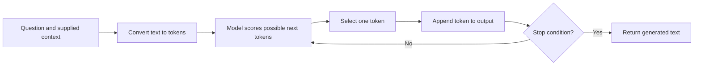

An employee asks, "How many days of annual leave do I get?" You send the question to a language model. It immediately replies, "You receive 25 days." The answer is clear, confident, and completely unsupported: you never supplied the company's policy.

**A language model can generate a convincing answer without having the information needed to answer correctly.** Understanding that distinction is the starting point for building reliable generative AI features.

Throughout this series, we will build toward a document assistant for **ExampleCo**, a fictional company. Its current policy says that full-time employees in Region A receive **20 days of annual leave per calendar year**. These are teaching examples, not real employment rules.

## The Smallest Useful Mental Model

**Generative AI produces content. A large language model produces text by repeatedly choosing the next small piece of text. Your application must supply the right information, permissions, and checks.**

| Term | Plain-language meaning | Example |
|------|------------------------|---------|
| Artificial intelligence (AI) | Broad family of techniques for tasks associated with intelligence | Recognizing speech, planning a route |
| Machine learning (ML) | Learning patterns from examples rather than hand-coding every rule | Learning which emails resemble spam |
| Generative AI | Models that produce content | Writing a paragraph or generating an image |
| Large language model (LLM) | A model trained on large amounts of data to work with language | Answering, summarizing, translating |
| Token | A piece of text handled by the model | A word, part of a word, or punctuation |
| Inference | Using an already trained model | Generating an answer to a question |

These categories overlap. "Generative" describes a capability, not a guarantee of accuracy, creativity, or safety. A language model can also perform classification by generating a label such as `spam`.

## Classification vs Generation

A classifier typically selects from a predefined set:

```text
Input:  "Win a free holiday now"
Output: spam
```

A generator produces a sequence:

```text
Input:  "Summarize this leave policy"
Output: "Full-time employees in Region A receive..."
```

Generation opens a much larger output space. That makes flexible interfaces possible, but also creates more ways to be wrong: an invented number, a missing exception, an incorrect citation, or an answer that sounds more certain than the evidence.

## How Next-Token Generation Works

Imagine the partial sentence:

```text
Full-time employees receive
```

The model assigns scores to possible next tokens, converts them to probabilities, and selects a token according to the decoding settings. It then repeats using the extended sequence.



The **probability is about the next token**, not the probability that the complete answer is factually correct. A familiar but wrong policy number can be a highly likely continuation.

This simplified loop describes ordinary autoregressive text generation. Actual serving systems add batching, caching, constraints, and other optimizations.

## Training Changes the Model; Inference Uses It

The model contains learned numerical values called **parameters** or **weights**.

| Stage | What happens | What it does not guarantee |
|-------|--------------|----------------------------|
| Pre-training | Learns language and other patterns from large datasets | Current, complete, or perfectly remembered facts |
| Post-training | Further training improves instruction-following or other behavior using examples and feedback | Perfect obedience or freedom from hallucination |
| Inference | Processes a request using the trained weights | Permanent learning from this request |
| Application retrieval | Fetches current information and supplies it to the request | Correct interpretation of every fetched passage |

When you paste a policy into a prompt, the model can use it **during that request**. You have not retrained its weights. If the next request contains neither the policy nor usable conversation history, the model does not automatically have that information.

Provider retention and training policies are a separate question. "Inference does not update weights in this request" does **not** mean "the provider never stores or later trains on submitted data." Check the service's actual data-handling settings.

## Transformer Intuition Without the Mathematics

Consider:

> "The employee asked the manager about her leave."

Which person does "her" refer to? Words need relationships, not just individual dictionary meanings.

**Attention** lets the model combine information from other token positions when computing a representation. Multiple attention heads can learn different useful relationships; many layers transform those representations before predicting the next token.

For typical decoder-only LLMs, generation uses **causal attention**: a position can use earlier positions, not future text that has not been generated.

Do not stretch the analogy too far:

- Attention is a learned numerical computation, not proof of human-like understanding.
- A high attention weight is not a trustworthy explanation of why an answer was produced.
- Access to a long input does not guarantee that the model will use every important detail correctly.

For application design, these limits matter more initially than deriving the matrix equations.

## Where an Answer Can Get Its Information

| Information source | Who controls it? | ExampleCo implication |
|--------------------|------------------|-----------------------|
| Learned weights | Model training process | May contain generic leave-policy patterns |
| Request context | Application and user inputs | Can contain the current Region A policy |
| Retrieved documents | Application's search system | Can provide current, permitted evidence |
| Tool results | Application's tool execution | Can provide the employee's actual balance |
| Persisted conversation state | Application storage | Can preserve earlier user clarifications |

**Policy entitlement and remaining balance are different questions.** A policy might establish 20 annual days, while a balance service knows that the employee has 7 unused days left. Neither should be invented from the other.

## Evolve the Naive Approach

### Version 1: Ask Without Evidence

```text
PSEUDOCODE
response = model.generate("How many leave days do I get?")
display(response.text)
```

This is a fluent text endpoint, not a trustworthy policy assistant. It lacks current policy, employee applicability, and a way to identify unsupported claims.

### Version 2: Supply a Small, Relevant Excerpt

```text
PSEUDOCODE
context = """
Source: leave-policy-v3, section 2
Full-time employees in Region A receive 20 days
of annual leave per calendar year.
"""

response = model.generate(
    instruction="Use the supplied policy. Ask for missing applicability details.",
    question="I am full-time in Region A. What is my annual entitlement?",
    reference=context
)

if response.is_incomplete or response.is_error:
    report_generation_failure()
else:
    validate_answer_and_sources(response, context)
```

This is better, not infallible. The model can still misread the excerpt. Production validation, permissions, and retrieval will be introduced incrementally rather than hidden inside a framework.

## Hallucination Is Not Just an Invented Fact

| Failure | Example | Appropriate response |
|---------|---------|----------------------|
| Unsupported fact | "Everyone receives 25 days" | Require evidence; do not present it as policy |
| Wrong applicability | Uses Region A policy for Region B | Obtain the missing region or employment type |
| Invented citation | Refers to a section that does not exist | Resolve source IDs in application code |
| Incorrect interpretation | Turns annual entitlement into remaining balance | Separate policy from account-specific data |
| Stale answer | Uses last year's policy | Retrieve the active version |
| Overconfident uncertainty | Gives a definite answer to an ambiguous question | Clarify or state the evidence gap |


**Confidence is not evidence.** Polished wording, a longer explanation, or a request to "be certain" does not verify a claim. Even a model's own numerical confidence needs calibration before it can support a product decision.


## What Belongs in the Model vs the Application?

| Responsibility | Prefer |
|----------------|--------|
| Drafting a readable explanation | Model |
| Looking up the active policy | Application retrieval |
| Checking document permissions | Application authorization |
| Calculating an exact balance | Deterministic service or code |
| Validating output shape | Application schema validation |
| Deciding what to do when evidence is missing | Explicit product rule, assisted by model output |

Use the model where flexible language is helpful. Do not replace reliable business rules with probabilistic prose.

## Related Concepts

- [Tokens, context, and sampling]({}) explains what fits in one request.
- [Prompt design and structured outputs]({}) turns a vague request into a clearer contract.
- [Retrieval-augmented generation]({}) supplies searchable evidence.

## Trade-offs

| Approach | Benefit | Limitation | Appropriate use |
|----------|---------|------------|-----------------|
| Model alone | Simplest integration | No automatic access to current private facts | Low-risk drafting |
| Model with supplied evidence | Better grounding | Context must be selected and checked | Explaining a known document |
| Model with retrieval | Scales evidence selection | Retrieval adds failure modes | Document assistants |
| Deterministic code without generation | Predictable rules and exact results | Less flexible language interface | Calculations and enforcement |

## Test Your Understanding

Try answering before expanding. Explain the missing assumption, not just the vocabulary.


No. One correct answer could reflect a guess or a coincidentally familiar pattern. Reliability requires current evidence, correct applicability, and tests across cases where the answer differs. Change the policy to 18 days and ask again: the architecture should follow the source, not a memorized number.



Ordinary inference does not update the model's weights. It supplies temporary request context. However, the service may retain inputs under its own settings, so this is not a privacy guarantee. Training behavior and data retention are separate concerns.



The model estimates likely continuation patterns, not a database constraint that the statement is true. Common policies or familiar phrases can dominate even when this particular company uses a different rule.



Yes. The underlying model can generate sequences even when the application restricts the answer to labels. The task is classification; the model family and decoding mechanism are a separate description.



No. The ID might be invented, inaccessible to the user, or attached to a passage that does not support the claim. Check source existence, permissions, active version, and claim support separately.



Not from entitlement alone. It needs leave taken, pending requests, carryover, adjustments, and the applicable rules. Prefer an authorized balance service for the calculation and use the model to explain its result.



The application may not have supplied yesterday's correction, and ordinary chat inference does not permanently update weights. Persist relevant state deliberately, respecting privacy and retention, or fix the authoritative source if it is wrong.



No. It can improve behavior and instruction-following, but cannot ensure that every future answer is true. Missing evidence, ambiguous instructions, distribution shifts, and generation errors remain possible.



The second response can repeat the same assumptions and errors. It may help, but independence requires a different source of evidence, such as a policy lookup, executable calculation, or human-reviewed reference.



Yes. A smaller model with the correct policy, a clear task, and good validation can outperform a larger model asked to guess. Compare complete systems on representative tasks, not parameter count alone.



No. Attention provides a mechanism for combining token information. Extraction errors, input limits, distractions, and imperfect reasoning can still hide the relevant rule or change its interpretation.



Not by itself. Attention weights describe internal numerical relationships, not a verified causal explanation. For a policy decision, show the authoritative rule and the deterministic inputs used to apply it.



Yes. It can repeat sensitive data supplied in the prompt or available through tools and history. Network access is only one possible exposure path; context selection and authorization still matter.



It can be appropriate when evidence is missing, but refusing every question makes the assistant useless. Measure both unsupported answers and unnecessary refusals. The goal is justified answers when evidence exists and explicit limits when it does not.



Yes. Syntax and factual support are different checks. A perfectly formatted response can use the wrong region, an expired policy, or an invented entitlement.



Complex rules need exact application, versioning, tests, and enforceable permissions. A prompt is useful for explaining rules, but deterministic services are usually a better authority for balances and eligibility decisions.



Evidence about contractors. The model must not expand the source's scope. It should retrieve the applicable policy or explain that the supplied passage only covers full-time employees.



Record the model identifier or deployment version where available, prompt version, retrieval configuration, source versions, and safe trace identifiers. These make the regression diagnosable without logging unrestricted document content.



No. A cutoff is not a promise that a specific private document was included or remembered accurately. Current company facts should come from authorized sources supplied by the application.



Supply one relevant, authorized, current excerpt and constrain the task to explaining it, with explicit handling for missing applicability. Validate the output. Add automated retrieval only when manual evidence selection becomes the bottleneck.

