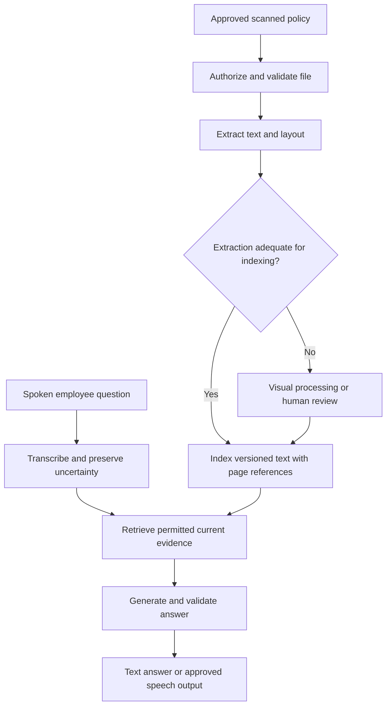

ExampleCo's newest policy is a scanned PDF. The "text" extractor returns nothing because each page is an image. An employee then asks a question by voice, and the transcription mistakes "not eligible" for "eligible."

**Multimodal systems work with more than one type of information, such as text, images, and audio. The important design question is where meaning can be lost as information moves between those forms.**

## Understanding vs Generating a Modality

| Capability | Input | Output | Example |
|------------|-------|--------|---------|
| Image understanding | Image and question | Text or structured result | Read a scanned policy table |
| Image generation | Text and optional images | Image | Create an illustration |
| Speech recognition | Audio | Transcript | Convert a spoken question to text |
| Speech generation | Text or other input | Audio | Read an answer aloud |
| Audio understanding | Audio and task | Interpretation or response | Identify relevant spoken content |

A model that accepts images does not necessarily generate them. A speech model is not automatically suitable for a document table. Check actual supported inputs, outputs, limits, and quality.

## Two Ways to Read the Scanned Policy

### Option A: Extract Text First

**Optical character recognition (OCR)** converts text visible in an image into machine-readable text.

```text
Scanned page -> OCR and layout extraction -> Text passages
             -> Existing retrieval and answer pipeline
```

Advantages:

- Text is searchable and inspectable.
- The normal RAG pipeline can be reused.
- Repeated questions need not reprocess the same image.

Risks:

- `20` may be read as `28`.
- A table header may attach to the wrong row.
- A footnote or negation may disappear.
- A diagram may not be represented well in plain text.

### Option B: Send the Image to a Capable Model

```text
Authorized page image + question -> Multimodal model -> Candidate answer
```

This can preserve visual relationships that plain OCR loses, but:

- The model can still misread a number or table.
- High-resolution pages can increase processing cost.
- Searching a large image collection still requires an indexing strategy.
- Citations need a page, region, or other stable location.

Direct visual input is not a guarantee of superior correctness.

## A Hybrid Pipeline



An "adequate extraction" gate needs defined checks: expected page count, nonempty content, table integrity checks where feasible, and review of critical numbers. A generic model confidence score is not enough.

## Preserve Structure and Provenance

For a scanned table:

```text
Region | Employment type | Annual days
A      | Full-time       | 20
B      | Full-time       | 30
```

The useful extracted record is not just `A 20 B 30`.

Keep:

- Source document ID and version.
- Page number and, when available, bounding region.
- Column headers and row associations.
- Extraction method/version.
- Review state or known uncertainty.

When a policy value is high-impact, consider a reviewed structured record instead of repeatedly asking a model to interpret the image.

## Audio Adds a Different Error Surface

A spoken question can be affected by accents, background noise, overlapping speakers, and similar-sounding terms.

For example:

```text
Spoken:      "Am I not eligible for carryover?"
Transcribed: "Am I eligible for carryover?"
```

Retrieval may work perfectly on the wrong question. When a critical ambiguity remains, ask the user to confirm the transcript or relevant detail.

Do not treat a voice recording or speaker resemblance as sufficient application authentication or approval for a consequential action.

## A Small Processing Skeleton

```text
PSEUDOCODE
identity = authenticate(request)
file = validate_supported_type_size_and_content(request.file)
require_upload_permission(identity, file.destination)

derived = extract_text_and_layout(file)
if derived.empty or derived.required_structure_invalid:
    mark_processing_needs_review()
    return explicit_processing_status()

store_versioned_derived_content(
    text=derived.text,
    source_locations=derived.locations,
    method_version=derived.method_version,
    permissions=inherited_source_permissions
)

if request.includes_audio_question:
    transcript = transcribe_with_approved_processor(request.audio)
    if critical_meaning_uncertain(transcript):
        return ask_for_transcript_confirmation()

continue_with_authorized_rag()
```

The uncertainty check is a product rule informed by evaluated signals and user context, not a universal speech-confidence threshold.

## Cost and Latency Need Modality-Specific Units

Text token estimates do not transfer blindly to images or audio.

| Input/output | Possible usage driver |
|--------------|-----------------------|
| Image | Resolution, number of crops/tiles, provider image accounting |
| Audio input | Duration, format, transcription or model-specific units |
| Audio output | Generated duration or model-specific units |
| Video | Frame sampling, duration, audio, and temporal processing |
| Extracted text | Text tokens plus extraction work |

Provider accounting differs. Estimate using the actual processing path and verify with measured usage.

Compare:

- One-time OCR plus repeated text retrieval.
- Repeated direct image-model calls.
- A hybrid that sends only selected pages to visual processing.

For frequently queried static policies, preprocessing can amortize cost. For a one-off chart question, direct image input may be simpler.

## Privacy and Injection Follow the Content

- A scanned page can contain personal data.
- An audio recording can contain unrelated speakers.
- A transcript or image caption is another derived copy.
- Instructions inside media remain untrusted content.
- A hosted OCR or speech service is a data processor too.

Apply source permissions, provider review, encryption, retention, deletion, and safe logging across originals and derivatives. See [GenAI safety]({}).

## Evaluate by Modality and Failure Type

| Slice | What to test |
|-------|--------------|
| Scans | Low contrast, rotation, small type |
| Tables | Headers, row alignment, merged cells |
| Numbers | Similar characters and decimal separators |
| Audio | Noise, accents, negation, unusual policy names |
| Mixed input | Whether the model attributes each claim to the right source |
| Generated speech | Whether spoken values match the validated text |

Do not let good clean-image performance hide poor scanned-table performance. Separate extraction/transcription errors from retrieval and generation errors.

## Related Concepts

- [RAG ingestion]({}) covers evidence preparation.
- [Evaluation]({}) covers slices and stage isolation.
- [Serving and cost]({}) covers complete-path budgets.

## Trade-offs

| Approach | Benefit | Limitation |
|----------|---------|------------|
| OCR then text RAG | Inspectable, reusable index | Loses some visual meaning |
| Direct image input | Preserves visual relationships | Cost and model interpretation errors |
| Speech-to-text first | Reuses text workflow | Transcription can change intent |
| Direct audio model | Integrated interaction | Harder stage isolation and provider-specific behavior |
| Human-reviewed extraction | Stronger critical-data confidence | Review effort and delay |

## Test Your Understanding

Try answering before expanding. Explain the missing assumption, not just the vocabulary.


No. It may consist of scanned images. Use an appropriate extraction or visual-processing path and expose processing failures rather than indexing empty text.



No. Input understanding and output generation are separate capabilities. Check the actual model interface.



The header establishes what the number applies to. Losing row or column associations can assign Region B's entitlement to Region A.



No. Both can misread content. Compare them on the actual documents, especially numbers, tables, footnotes, and low-quality scans.



Speech recognition changed the question's meaning. Retrieval and generation can behave correctly relative to the wrong transcript, so evaluate stages separately.



Not reliably. Audio processing has modality-specific units and limits. Use the actual provider's accounting and measured duration or usage.



They support precise citations, human verification, and extraction debugging. A plain text snippet alone can lose its visual source context.



Not by itself. The application must authenticate the caller and bind approval to the exact action through its trusted confirmation process.



No. The service is another processor receiving source content. Only authorized, appropriate material should be sent under approved data-handling settings.



The extraction cost is amortized across many text-based queries. Reprocessing the same images for every question may be unnecessary.



No. A model or OCR system can turn them into model-visible content. Treat them as untrusted reference data and retain external enforcement.



No. A single misread digit or missing negation can remain fluent. Validate critical values and source structure explicitly.



It makes critical values explicit, versioned, and testable. Generation can then explain verified fields rather than repeatedly reconstructing them from a difficult scan.



No. It can contain the same personal or confidential content and may be easier to search and copy. Apply appropriate access and retention controls.



Pronunciation or synthesis can alter how a number, acronym, or date is understood. Test that spoken output preserves the validated answer's meaning.



No. Evaluate low contrast, rotation, small fonts, tables, and real document layouts separately. Average scores can hide poor slices.



Mark the version failed or needing review and show an explicit status. Do not activate it as a complete searchable document.



Not automatically. Track derivatives and apply the deletion/retention policy to them, including caches and approved logs.



It preserves visual processing where needed while reducing repeated image work, cost, and unnecessary data exposure. Selection still needs evaluation and authorization.



Every conversion can change meaning. Preserve provenance, evaluate the conversion stage, and avoid treating the final fluent answer as proof that the original image or audio was understood correctly.

