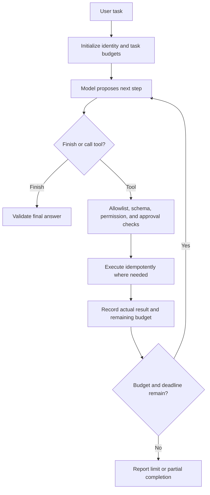

The ExampleCo assistant can explain annual leave entitlement, but an employee asks, "How much leave do I have left, and can you prepare a request for next Friday?" A policy document cannot answer the balance question or submit anything.

The model needs an application capability. **Tool calling lets the model propose a structured operation; application code decides whether and how to execute it.** An agent is one way of choosing those operations, not a way to bypass their controls.

## A Tool Call Is a Proposal

```json
{
  "tool": "get_leave_balance",
  "arguments": {
    "as_of_date": "2026-10-28"
  }
}
```

The application supplies the authenticated employee identity. The model does not get to set `employee_id` to any value it likes.

| Step | Owner |
|------|-------|
| Propose a tool and arguments | Model |
| Parse and validate the proposal | Application |
| Check permission and business rules | Application/service |
| Execute the operation | Tool service |
| Return an actual result or error | Tool service |
| Explain the result | Model or server template |

The model's statement "balance retrieved successfully" is not a substitute for a real tool result.

## Workflow vs Agent

A **workflow** follows predefined control flow:

```text
Authenticate -> Get balance -> Retrieve policy -> Explain
```

An **agent** lets the model choose some next steps based on the task and intermediate results:

```text
Choose tool -> Execute -> Inspect result -> Choose next step or stop
```

| Question | Prefer a fixed workflow | Consider an agent |
|----------|-------------------------|-------------------|
| Are the steps known? | Yes | Not always |
| Is predictable latency important? | Strong fit | Needs strict budgets |
| Do intermediate results change the plan? | Limited branching | Potentially useful |
| Must actions be tightly audited? | Simpler | More state and explanation needed |

For a read-only policy assistant, an agent is usually unnecessary. Start with a workflow and add autonomy only when actual tasks require it.

## A Bounded Agent Loop



Example limits might be eight steps, a 15-second deadline, and a task token budget. These are product choices, not universal defaults.

Every model call, tool call, retry, and parallel branch should count against the task's budget.

## Tool Schemas Are Necessary but Insufficient

A schema can require a valid date string. It cannot alone establish:

- Whether the date is a working day.
- Whether the caller has sufficient balance.
- Whether the caller may act for another employee.
- Whether the employee approved this exact submission.
- Whether the action already happened.

Validate business semantics in the authoritative service. Never execute arbitrary model-generated code as an alternative to a narrow tool API.

## Consequential Actions Need Real Confirmation

For a leave submission:

1. Generate a **draft** with exact dates and leave type.
2. Show it through the application's confirmation UI.
3. Record approval for that action ID, caller, normalized arguments, and expiry.
4. At execution, recheck authorization and business constraints.
5. Reject changes to approved arguments unless the user approves again.
6. Submit using a stable idempotency key.

The model cannot approve its own proposal. A generic "yes" from an unrelated earlier message is not sufficient evidence for a new action.

## Idempotency and Uncertain Outcomes

If submission times out, the external service may already have created the request.

```text
Submit action A -> Service creates request R -> Network response is lost
```

Blindly retrying with a new action ID can create a duplicate.

Use a stable operation ID and an idempotent downstream API where available. If outcome is uncertain, query status or reconcile using that operation ID. Do not invent a successful result, and do not claim cancellation undid a completed action.

See [idempotency]({}).

## Persist State That Must Survive Failure

| State | Why retain it? |
|-------|----------------|
| Task ID and caller scope | Resume under the correct identity |
| Proposed/approved action arguments | Prevent approval substitution |
| Step history and actual results | Diagnose and resume safely |
| Idempotency key and operation status | Reconcile uncertain writes |
| Remaining budgets and deadline | Prevent restart-based limit bypass |
| Final status | Distinguish completed, failed, cancelled, and partial |

Keep retention bounded and sensitive tool results protected. Persistent agent state is application data, not automatic model learning.

## An Executor Skeleton

```text
PSEUDOCODE
for step in range(task.max_steps):
    require_deadline_and_budget_remaining(task)
    proposal = model_next_step(task.safe_context)
    validate_proposal_shape(proposal)

    if proposal.kind == "finish":
        return validate_final_answer(proposal.answer, task.actual_results)

    tool = lookup_allowlisted_tool(proposal.tool_name)
    arguments = tool.validate_arguments(proposal.arguments)
    require_current_permission(task.caller, tool, arguments)

    if tool.has_consequential_effects:
        require_matching_unexpired_approval(task, arguments)

    result = execute_with_deadline_and_stable_operation_id(tool, arguments, task)
    persist_actual_result_or_explicit_uncertainty(task, result)

return report_step_limit_with_actual_partial_state(task)
```

Tool errors should become explicit task state. They are not instructions to broaden permissions or silently substitute fabricated data.

## What MCP Does and Does Not Do

**Model Context Protocol (MCP)** standardizes interactions through which clients can discover and use server-provided tools, resources, and prompts.

It can reduce custom integration work. It does not automatically:

- Decide which tool is appropriate for a business task.
- Make a server or tool result trustworthy.
- Grant an employee permission to a resource.
- Provide correct approval or idempotency semantics.
- Bound an agent's total cost or autonomy.

MCP has authorization mechanisms for applicable transports, but protocol-level authorization does not replace your application's resource-level business policies.

Treat newly connected tool servers as new data and action boundaries that require explicit review.

## Failure Cases to Make Visible

| Failure | Correct behavior |
|---------|------------------|
| Unknown tool name | Reject and record the invalid proposal |
| Invalid arguments | Return bounded validation feedback or fail |
| Unauthorized read | Deny without exposing the data |
| Tool timeout on a write | Mark outcome uncertain and reconcile |
| User cancels after a write | Report the actual effect; do not claim rollback |
| Step/token limit | Stop and describe genuine partial progress |
| Malicious tool result | Treat as data; do not adopt new authority |

## Related Concepts

- [Safety and privacy]({}) defines trust boundaries.
- [Saga pattern]({}) covers explicit compensation.
- [Job scheduling]({}) covers leases and recovery.

## Trade-offs

| Approach | Benefit | Limitation |
|----------|---------|------------|
| Fixed workflow | Predictable, easy to test | Limited flexibility |
| Model-selected tools | Adapts to varied requests | Needs bounded control and careful evaluation |
| Read-only tools | Lower action risk | Can still leak or consume sensitive data |
| Write tools | Complete real tasks | Confirmation, idempotency, and reconciliation required |
| MCP integration | Standardized connectivity | Trust and business policy remain application concerns |

## Test Your Understanding

Try answering before expanding. Explain the missing assumption, not just the vocabulary.


No. Check the allowlist, argument semantics, caller permissions, budgets, and any required approval before execution.



The model can be mistaken or influenced. Bind the tool invocation to verified application identity and separately authorize any delegated access.



Not in the useful architectural distinction here. A fixed workflow can call tools without allowing the model to plan its next operations.



When the supported task has known steps and predictable latency, correctness, and auditability matter more than open-ended planning.



No. Approval must bind to the normalized arguments. Changed consequential inputs require renewed confirmation.



Not without risking duplication. The first request may have succeeded. Reuse an idempotency key or reconcile the original operation's status.



Report that the action occurred and distinguish any available cancellation/compensation process. Cancelling the agent loop does not undo an external effect.



Not automatically. It can expose highly sensitive data or trigger costly work. Permissions always apply, and some reads may need additional consent.



Otherwise repeated crashes or resumptions can bypass step, token, or spend limits. The budget belongs to the task, not only the current process.



No. MCP standardizes interaction, not the truth or authority of every returned value. Validate sources, permissions, and result semantics.



Treat that text as untrusted data. Any proposed next call still passes the independent executor's policy and permission checks.



It may be outside the permitted period, already taken, a non-working day, or incompatible with balance rules. Domain validation belongs in the authoritative service.



No. Success requires an actual service result or reconciled operation state. Generated claims must not become authoritative action records.



One tool or model call can hang for a long time. Step counts do not bound latency, resource occupancy, or user wait time.



It greatly expands the capability and validation surface. Narrow tools give explicit operations, resource scope, argument contracts, and audit points.



No. It must load the persisted operation state, recheck current authority and approval validity, and reconcile any uncertain prior execution.



Some real steps may have succeeded while others failed or were cancelled. Report each actual outcome rather than returning an all-or-nothing success narrative.



No. Some effects are irreversible, and compensations can fail or need separate approval. Define them explicitly rather than assuming an automatic undo.



Not by ordinary persistence alone. It stores application context for later requests and brings its own privacy, retention, and correctness requirements.



A measured class of tasks that genuinely needs adaptive sequencing, with better outcomes after accounting for latency, failure modes, permissions, and operational cost.

