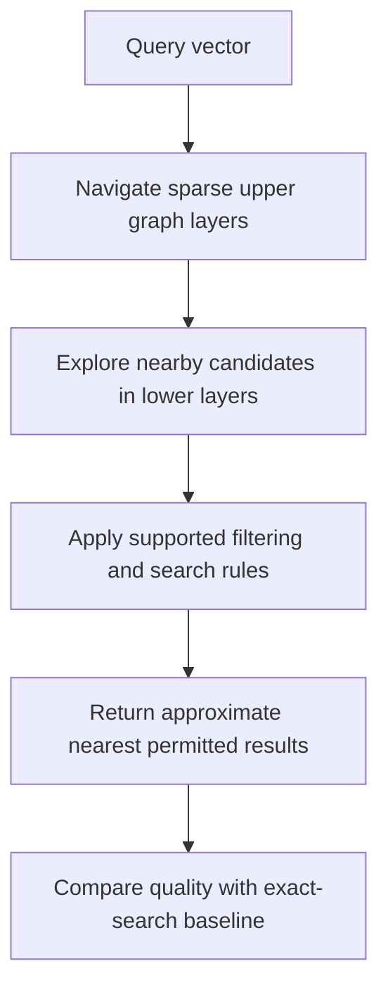

The ExampleCo assistant can compare a question with ten passages instantly. The planning corpus used throughout this track is 100,000 documents and 50 chunks each: **five million passages**, queried at a **30 questions/s** peak. A full scan becomes too expensive at that load. Someone proposes a vector database. Another engineer asks, "Do we need a new database, or just a better index?"

**Vector search is a capability. A vector index accelerates that capability. A vector database adds storage and operational features around it.** They are related, but they are not interchangeable terms.

## Begin With the Baseline

An exact search calculates the distance to every eligible vector and sorts or selects the nearest results.

For ExampleCo's **5 million vectors** of **768 float32 values**:

```text
Raw vector storage = 5,000,000 * 768 * 4 bytes
                   = 15,360,000,000 bytes
                   = 15.36 GB, using decimal units
```

That excludes text, metadata, database overhead, replicas, and the index. The [case-study estimate]({}) adds about 10 GB of chunk text and 2.5 GB of chunk metadata. **15.36 GB is not the database size.**

A full scan does approximately `5,000,000 * 768 = 3.84 billion` coordinate comparisons per query. Hardware and optimized libraries matter greatly, but the multiplication explains why an index can become attractive.

## Exact vs Approximate Nearest Neighbors

**Nearest neighbors** are vectors closest to the query under the chosen distance metric.

An **approximate nearest neighbor (ANN)** index avoids examining every vector. It aims to return close matches quickly, accepting that it might miss some true nearest neighbors.

| Search type | Main benefit | Main cost |
|-------------|--------------|-----------|
| Exact | Reference result for the chosen vectors and metric | Work grows with eligible corpus size |
| Approximate | Lower latency or resource use at scale | Possible missed neighbors, index tuning |

Exact geometric neighbors are not necessarily the passages a human considers most relevant. **ANN recall** and **semantic retrieval quality** are separate measurements.

## HNSW: Navigate a Graph Instead of Scanning Everything

**Hierarchical Navigable Small World (HNSW)** builds a graph connecting vectors. Sparse upper layers provide larger navigation steps; lower layers refine the search among more points.



The diagram is conceptual. Engines integrate filtering into graph search in different ways; some filter before, during, or after candidate generation.

Three knobs appear in almost every HNSW API, even when the vendor renames them:

| Parameter | What it controls | What you pay | ExampleCo starting point |
|-----------|------------------|--------------|--------------------------|
| `M` | Maximum links stored per node | Memory and build time. More links usually navigate better. | 16. Move toward 32-64 only if measured recall misses the gate. |
| `efConstruction` | Candidate-list size while inserting a node | Slower ingestion and full rebuilds, usually a better graph | 128-200. Daily ingestion is only 1,500 documents, so this cost shows up on a 5-million rebuild, not on a normal edit. |
| `efSearch` | Candidate-list size at query time | Query latency. Changing it does not require a rebuild. | 64-128. Raise it until filtered recall stops improving inside the latency budget. |

These are planning defaults, not universal optima. There is no latency or recall guarantee for "using HNSW."

A lower-bound memory sketch, not a vendor quote:

```text
One direction of int64 neighbor IDs ≈ 5,000,000 * M * 8 bytes
M = 16 => 640 MB
```

Real graphs store links in both directions and across layers, on top of the 15.36 GB of vectors. Measure the resident set before buying hardware. Do not multiply by a blog-post factor and call it capacity.

`efSearch` also changes meaning once a filter is applied. If the nearest graph neighbors belong to another tenant or an inactive version, a small `efSearch` followed by a post-filter returns an empty page even though permitted passages exist. The engine must apply the filter during traversal, or the query must over-fetch until it has enough permitted hits, with a hard cap so a rare permission set cannot scan the corpus. Dropping the filter to "get results" is an authorization bug.

At this size, start in the existing relational database with a vector index. A dedicated vector service is justified when measured contention, filtered recall, or an operational feature requires it — not because the raw vectors are 15.36 GB.

## What Must Be Stored?

Vectors alone are not a document assistant.

| Field | Why it is needed |
|-------|------------------|
| Tenant ID | Prevent cross-organization mixing |
| Document ID and version | Identify the source and lifecycle |
| Chunk ID and source location | Resolve a precise citation |
| Text or protected text reference | Supply evidence to generation |
| Embedding model/version | Enforce compatibility |
| Active/deleted state | Exclude retired material |
| Permission metadata or reference | Determine who can use the passage |
| Region, document type, effective date | Support applicability filters |
| Vector | Rank by semantic similarity |

Keep authoritative permissions and active-version state in a system with the consistency required by the product. Search metadata can accelerate filtering, but stale copies must not become the final authority for sensitive access.

## Database Extension vs Dedicated Service

If PostgreSQL already stores documents and permissions, vector support such as **pgvector** can be a reasonable starting point:

- Reuse transactions, backup practices, and existing expertise.
- Keep document metadata close to relational authorization data.
- Add exact search first, then an index if measurements justify it.

A dedicated vector service can be useful when the required scale, distributed indexing, query features, or operational model is a better fit. It also introduces another consistency boundary and another system to secure.

Choose by measured workload, not by whether the architecture diagram contains a fashionable database.

## An Illustrative Query

```sql
-- Illustrative PostgreSQL + pgvector query.
-- :query_vector and :tenant_id are bound parameters.
SELECT chunk_id, document_id, document_version,
       embedding <=> :query_vector AS cosine_distance
FROM policy_chunks
WHERE tenant_id = :tenant_id
  AND is_active = TRUE
ORDER BY embedding <=> :query_vector
LIMIT 10;
```

This is **not a complete authorization implementation**. It shows a tenant filter and active-state filter, not employee-specific permissions.

The request's tenant must come from verified identity, not an arbitrary body field. Before source text reaches any reranker or generator, enforce the current document permission against authoritative state. Use database policies or a protected retrieval service to make that boundary difficult to bypass.

Also note that smaller cosine distance is better. Do not sort a distance descending as if it were a similarity score.

## Filtering Can Change Recall

Suppose the nearest 100 global passages all belong to another tenant. Searching globally for 10 results and then deleting forbidden results returns nothing, even when useful permitted passages exist.

Options include:

1. Search a physically separated tenant collection.
2. Use an engine that combines metadata filters with vector search.
3. Increase candidate effort or use filtered/exact fallback for a small eligible set.
4. Recheck permissions before loading text into downstream processors.

Do not solve sparse filtered results by dropping the filter.

| Filtering point | Benefit | Risk |
|-----------------|---------|------|
| Before candidate search | Search only eligible data | Requires suitable index/query support |
| During search | Can balance graph navigation and filtering | Engine-specific recall behavior |
| After candidate search | Easy to add | Can return too few permitted results |
| Before downstream text use | Essential authorization boundary | Does not recover candidates already missed |

## Updates, Deletions, and Model Changes

Document updates are often a multi-step operation:

1. Prepare new chunks and vectors under a new version.
2. Validate extraction and index readiness.
3. Atomically change the authoritative active-version pointer.
4. Exclude the old version from new requests.
5. Invalidate dependent caches and remove obsolete index entries.

For a deletion or permission revocation, block future use at the authoritative check immediately according to the product's consistency contract; asynchronous index cleanup can follow.

For an embedding-model migration, create a parallel index using compatible vectors. Test it, switch the query encoder and index together, and retain a rollback plan.

## What to Measure Before Choosing

- Search latency at realistic concurrency and filter selectivity.
- ANN recall against exact nearest neighbors.
- Relevant-evidence recall against human-labeled questions.
- Index build time, write/update throughput, and visibility lag.
- Memory and storage including replicas and metadata.
- Behavior during node failure, deletion, and permission changes.

Do not report only an unfiltered single-query benchmark when production traffic is filtered and concurrent.

## Related Concepts

- [Embeddings and semantic search]({}) covers representation and similarity.
- [Database indexes]({}) explains the general index trade-off.
- [RAG ingestion]({}) covers source lifecycle.

## Trade-offs

| Choice | Prefer when | Watch out for |
|--------|-------------|---------------|
| Exact scan | Eligible set is small or a baseline is needed | Linear comparison work |
| HNSW-style index | Low-latency ANN fits the workload | Memory, tuning, and filtered recall |
| Existing database with vector support | Simpler ownership and relational integration matter | Shared resource contention and workload limits |
| Dedicated vector service | Its scale/features justify another system | Cost, security, and metadata synchronization |
| Tenant-separated indexes | Isolation and workload separation matter | Many small indexes and operational overhead |

## Test Your Understanding

Try answering before expanding. Explain the missing assumption, not just the vocabulary.


No. RAG requires retrieving evidence, which can use keyword search, relational queries, exact vector comparisons, or other methods. A vector database is one implementation choice.



No. It measures recovery of exact geometric neighbors under a specific test. Those neighbors may not be relevant, current, permitted, or correctly interpreted by the generator.



All ten may be forbidden even though permitted relevant passages exist farther down the global ranking. Raise `efSearch` or use filter-aware traversal, with a hard cap, rather than post-filtering a tiny global top-k. Do not weaken authorization to fill the page.



No. It includes only 5 million vectors, 768 float32 values each. Graph links, text, metadata, database overhead, replicas, and spare capacity add more. At `M = 16`, one direction of int64 neighbor IDs is already about 640 MB, and a real graph stores more.



Exactness refers to the chosen distance computation, not human relevance. A perfectly computed nearest vector can correspond to the wrong region or an irrelevant but linguistically similar passage.



It favors more distant passages rather than nearer ones. Check whether an API returns distance or similarity and use the correct ordering.



No. Derive tenant scope from verified identity and enforce it server-side. A body field is untrusted unless separately authorized against that identity.



Not necessarily. Employees within one tenant can have different permissions. Enforce document-level access before sending text to a reranker, generator, or user.



No. An authoritative active/deleted-state check should block use while asynchronous cleanup catches up. The index is not the final authority for source eligibility.



It can improve recall but consume more CPU and latency, especially under concurrency. Measure task success and tail latency together instead of maximizing one index metric.



No. Filtering integration differs by engine and version. Test your actual query plan and selective-filter workload rather than assuming behavior from the algorithm's name.



It can reuse existing expertise, transactions, metadata, and backups while the workload is modest. A new service is justified by requirements, not by semantic search alone.



It helps detect how much recall the approximate index loses and whether tuning or an upgrade changed behavior. It also separates index approximation errors from embedding-model quality.



Only if compatibility is explicitly guaranteed. Otherwise the coordinate spaces differ and results become unreliable. Switch the matched query encoder and index as one versioned configuration.



No. The index can miss it, filters can exclude it, or the embedding can rank it poorly. Larger k also adds cost and noise. Diagnose the actual failure.



Realistic tenant and document filters, query distribution, concurrent load, updates, and tail latency. These can materially change recall and performance.



A URL alone may not preserve version, exact location, permission context, or stable access. Keep durable source identifiers and resolve access-controlled citations through application metadata.



Not if completeness matters. Validate the new version and activate it atomically, retaining the old active version until the replacement is ready or explicitly marking the document unavailable.



No. A cached answer can reference a document whose access changed. Revalidate source dependencies and current authorization before reuse.



A measured requirement that the existing system cannot meet well, such as a particular scale, availability, filtering feature, or operational model. Its benefit must outweigh added synchronization, security, and ownership costs.

