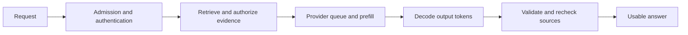

The ExampleCo assistant works during a small demonstration. At lunchtime, requests queue behind the provider's quota. Some users retry repeatedly. The UI shows the first word quickly, but complete answers take 20 seconds, and the bill includes several failed attempts for each successful answer.

**Serving is about delivering a validated result under load, not merely obtaining a model response once.** Measure latency, capacity, reliability, quality, and cost together.

## Managed API vs Self-Hosted Model

| Choice | What you gain | What you own |
|--------|---------------|--------------|
| Managed API | Fast setup, provider-managed model serving | Quotas, vendor dependency, data-handling review, per-usage cost |
| Self-hosted model | More deployment and infrastructure control | Hardware, runtime, capacity, updates, security, availability |

Self-hosting does not automatically make a system cheaper, private, or accurate. Managed APIs do not automatically satisfy a company's privacy requirements.

Start with the simplest option meeting quality, data-handling, quota, and latency requirements. Model availability, pricing, and limits change; verify them for the actual deployment.

## Prefill vs Decoding

- **Prefill:** Process the input context and prepare the model state used for generation.
- **Decoding:** Generate output tokens, typically one step after another for an individual sequence.

Long input can increase prefill work; long output increases decoding work. Network delay, queueing, retrieval, and validation add latency outside both stages.



An illustrative latency breakdown:

| Stage | Example budget |
|-------|----------------|
| Application and identity | 100 ms |
| Retrieval and source checks | 250 ms |
| Provider queue and prefill | 650 ms |
| Output generation | 2,500 ms |
| Validation and release checks | 200 ms |
| **Total** | **3,700 ms** |

These are teaching assumptions, not a model benchmark. Measure distributions, particularly tail latency under realistic load.

## Three Different Time Measurements

| Metric | Measures |
|--------|----------|
| Time to first byte/token | When delivery starts |
| Time to model completion | When generation finishes |
| Time to validated completion | When the application has a usable result |

If the UI streams immediately, users may perceive progress sooner. That does not reduce total model work or guarantee that the partial text is correct.

## Streaming Is a Product Decision

Server-Sent Events (SSE) can deliver one-way text updates over HTTP. See [real-time transport]({}).

For streamed responses:

- Mark partial content provisional.
- Distinguish completion, refusal, cancellation, timeout, and disconnect.
- Propagate cancellation to the provider when supported.
- Do not assume a disconnected client stopped provider billing.
- Do not treat partial structured output as executable arguments.
- Decide what source checks can happen before delivery.

If policy requires checking final output and current source permissions before any answer text is released, **buffer the answer**. You can still stream safe progress events such as "searching policies," but not unvalidated sensitive answer text.

Once a token is delivered, later revocation cannot retract it.

## Capacity: Requests and Tokens Are Both Resources

Suppose peak admitted traffic is **40 requests/second**, with an average in-flight duration of **3 seconds** at that load:

```text
Average concurrent requests = arrival rate * average duration
                            = 40/s * 3 s
                            = 120
```

This is Little's law for a stable system. It is not a guarantee of p99 capacity; add headroom and test queueing.

A provider might separately limit requests/minute and tokens/minute. With 2,000 input and 400 output tokens per request:

```text
40 requests/s * 60 s * 2,400 tokens = 5,760,000 tokens/minute
```

Actual quota accounting can differ. Check the provider's rules, including reserved output or model-specific tokens.

## Cost: Show the Arithmetic and the Assumptions

Use **hypothetical** rates:

- Input: **$1 per million tokens**.
- Output: **$4 per million tokens**.
- Request: **2,000 input tokens + 400 output tokens**.

```text
Input cost  = 2,000 / 1,000,000 * $1 = $0.0020
Output cost =   400 / 1,000,000 * $4 = $0.0016
Model total per request             = $0.0036
10,000 requests/day * $0.0036        = $36/day
```

That excludes embeddings, retrieval, reranking, storage, network, retries, and operational work. These are not provider prices.

The roadmap's simpler example, `10,000 * $0.002 = $20/day`, is valid only when `$0.002` is the assumed **average total cost per request**. Do not mix assumptions from different estimates.

Use **cost per successful task** for product decisions:

```text
all task-related spend / successfully completed tasks
```

A cheaper model can be more expensive per success if it needs many retries or manual corrections.

## Reduce Waste Before Adding Infrastructure

| Improvement | Why it can help | What to verify |
|-------------|-----------------|----------------|
| Select relevant passages | Fewer input tokens and less distraction | Evidence coverage does not fall |
| Ask for concise output | Less decoding | Required detail remains |
| Use the smallest adequate model | Lower serving cost | Quality and safety gates pass |
| Remove duplicate tool calls | Less unnecessary processing | State remains correct |
| Batch offline work | Better throughput | Delay is acceptable |
| Cache safe reusable results | Avoid repeated work | Access and freshness are valid |

A two-stage router that always calls an expensive classifier before generation may erase the savings it was intended to create. Measure the complete path.

## Three Caches That Should Not Be Confused

| Cache | Reuses | Important limitation |
|-------|--------|----------------------|
| Application answer cache | A prior answer and source dependencies | Must enforce caller access, applicability, and freshness |
| Provider prompt/prefix cache | Processing of repeated input prefixes | Provider-specific behavior and billing |
| Model key/value cache | Internal attention state used during generation | Runtime optimization, not a source-of-truth answer cache |

An application answer-cache key or validation record may need:

```text
tenant + verified applicability + access scope
+ normalized question + model/prompt versions
+ source versions + source/authorization epochs
```

Recheck dependencies before reuse. A semantic near-match is not enough: "entitlement" and "remaining balance" are related questions with different answers.

## Admission Control and Bounded Retries

```text
PSEUDOCODE
require_request_and_token_budget(caller)
slot = acquire_bounded_concurrency_slot(deadline)
if slot unavailable:
    return explicit_rate_or_capacity_error()

try:
    for attempt in [1, 2]:
        result = call_provider_with_deadline()
        if result.success:
            return validate_and_recheck_sources(result)
        if not result.retryable or attempt == 2:
            report_provider_failure(result)
        wait_bounded_backoff_with_jitter_within_deadline()
finally:
    release(slot)
```

The pseudocode intentionally allows at most two attempts. Use provider guidance for rate limits and do not retry permanent input errors.

Retries may repeat billable work even when no successful response was received. Count them against task budgets.

## Outages Need Honest Behavior

- Circuit breakers can stop repeated calls to a failing provider.
- Bounded queues and concurrency limits prevent unbounded memory growth.
- An approved fallback model needs its own evaluation and data-handling review.
- Cached answers can be used only when their evidence and permissions are still valid.
- If no safe fallback exists, return an explicit service error.

Do not turn a model outage into a fabricated `unsupported` policy response or a canned policy answer. Operational failure and missing evidence are different states.

See [circuit breakers]({}) and [back-pressure]({}).

## Trade-offs

| Choice | Benefit | Limitation |
|--------|---------|------------|
| Immediate answer streaming | Faster visible progress | Cannot retract delivered text |
| Buffered validated answer | Stronger release checks | Higher perceived wait |
| Large batches | Better offline throughput | Queueing latency |
| More context | More available evidence | Input cost and prefill work |
| Aggressive caching | Lower latency and spend | Authorization and stale-answer risk |
| Self-hosting | More runtime control | Significant operational ownership |

## Test Your Understanding


Only time to first token is 200 ms. The full answer and validation may take much longer. Report time to usable completion separately.



Not inherently. It changes delivery timing. Cost depends on actual processing and provider billing, including whether cancellation stops generation.



Approximately 120 in a stable system. This is not a p99 capacity target; account for variability, queueing, and headroom.



A small number of long requests can consume many tokens. Model traffic has both per-request and per-token resource dimensions.



Input costs $0.0020 and output $0.0016, totaling $0.0036 before other services and failed attempts.



It may require more retries, longer prompts, extra validation, or manual repair. Include all attempts and task-level costs.



Not without verifying applicability. The same wording can require a different policy and answer.



No. Prefix caching reuses input processing; answer caching reuses an actual response and needs evidence and permission validity.



No. Propagate cancellation where supported and inspect actual usage. A client disconnect may not terminate provider computation.



Usually not. Backoff helps transient conditions, not an unchanged invalid request. Classify errors and surface permanent failures clearly.



They amplify traffic, occupy resources, increase cost, and delay recovery. Use bounded attempts, jitter, deadlines, and circuit breakers.



No. Access controls, logging, backups, network boundaries, operators, and data retention still matter. Self-hosting changes ownership, not the need for governance.



Waiting to form a batch adds latency. Throughput-oriented scheduling and interactive response time are different optimization goals.



It may be wrong for the caller, stale, or unauthorized. Use only a validated eligible cached result, otherwise return an explicit service failure.



The answer may expose content the caller can no longer use. Cache reuse must obey the same current authorization rules as a fresh response.



No. It is an internal inference optimization. Active policy versions remain an application/source-of-truth concern.



Input processing, tokenization, provider queueing behavior, and attention work can increase. Output length is only one part of latency.



Daily average hides business-hour concentration and bursts. Size and test against the expected peak distribution and concurrent work.



They cannot retract delivered tokens. If the required guarantee is final permission checking before answer release, buffer answer text and stream only safe progress events.



Remove irrelevant and duplicated evidence while preserving required support, then measure quality, token usage, and latency. This can improve both clarity and cost without new infrastructure.

