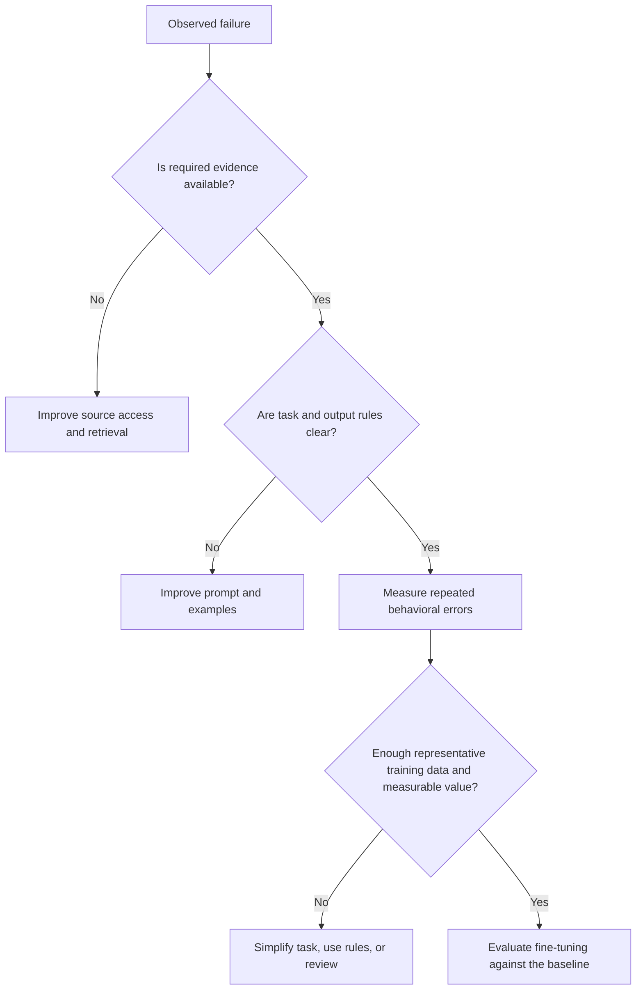

The ExampleCo assistant has three reported problems:

1. It writes answers that are too long.
2. It does not know the policy published yesterday.
3. It inconsistently maps unusual policy questions into the company's internal categories.

The team proposes "fine-tune the model" for all three. That skips the most important question: **Is the failure about instructions, missing information, or a learned task behavior?**

## Three Different Levers

| Technique | What changes? | What stays unchanged? |
|-----------|---------------|-----------------------|
| Prompting | Instructions, examples, and context for a request | Model weights |
| Retrieval-augmented generation (RAG) | External evidence supplied at request time | Answer model's weights |
| Fine-tuning | Model parameters using additional training examples | Facts are not automatically synchronized with live systems |

These are not mutually exclusive architectures. A fine-tuned model still receives a prompt and can still use RAG.

## Diagnose Before Choosing



A missing database row is not a training problem. A confusing instruction is not automatically a model-capacity problem.

## Prompting: The Lowest-Cost First Experiment

If answers are too verbose, first try:

```text
Explain the applicable policy in at most three short sentences.
State the annual entitlement, applicability, and source.
Do not add general HR advice.
```

If categories are unclear, define them and supply a few contrasting examples.

Prompting is attractive because it is easy to revise and evaluate. It can become unwieldy when instructions or examples grow very large, and behavior is still probabilistic.

Do not keep extending a prompt to compensate for a task that should be a deterministic lookup.

## RAG: Bring the Current Book to the Exam

Use retrieval when correctness depends on current or private information:

- The active annual leave policy.
- A newly published exception.
- A document that only some employees may access.
- An answer requiring a verifiable citation.

The benefit is **externalized knowledge**: changing the authoritative source and its index can update future answers without training the model again.

The cost is an evidence pipeline. Retrieval can miss a passage, return stale data, or supply distracting text. Fix and measure those failures directly.

See [RAG]({}) for the request flow.

## Fine-Tuning: Practice a Repeatable Task

Fine-tuning adjusts a model using additional examples. In supervised fine-tuning, examples demonstrate desired input/output behavior.

A possible ExampleCo use:

```text
Input:
  Question: "Can I move unused holiday into next year?"

Desired classification:
  {"intent": "carryover", "needs_account_data": false}
```

If thousands of representative, reviewed examples exist and prompting has a measured ceiling, fine-tuning might improve this mapping or allow a smaller model to meet the task requirements.

It is a poor first solution for:

- Yesterday's policy update.
- Per-user authorization.
- Exact remaining balances.
- Reliable deletion of one learned fact.
- A schema constraint that application code can enforce.

Fine-tuning can teach facts, but facts stored in weights are difficult to update, inspect, cite, and selectively forget. That makes it a weak source of authority for changing company policy.

## A Responsible Training/Evaluation Loop

1. Define the failure and business metric.
2. Establish prompt-only and retrieval baselines.
3. Collect reviewed examples with appropriate consent and data handling.
4. Split data by meaningful units, such as document family or time.
5. Train using the training split only.
6. Tune decisions on validation data.
7. Compare once against a held-out test set.
8. Test safety, refusal behavior, latency, and cost.
9. Roll out gradually and retain the old model/configuration.

Randomly splitting near-duplicate policy questions can leak the same pattern into training and testing. A high score then overstates generalization.

## LoRA Without the Matrix Derivation

**Low-Rank Adaptation (LoRA)** is a parameter-efficient fine-tuning method. It keeps base weights frozen and trains small additional parameter sets, often called adapters, for selected model layers.

Think of it as learning a compact adjustment instead of rewriting every learned weight.

| Property | Implication |
|----------|-------------|
| Fewer trainable parameters | Can reduce training-memory and storage requirements |
| Base model remains needed | An adapter is not generally a standalone model |
| Adapter tied to a compatible base | Model/version mismatches can break deployment |
| Learned behavior still changes | Evaluate quality and safety, not just memory savings |

LoRA does not mean training is free. You still need data preparation, compute, evaluation, deployment, and model lifecycle ownership. Its effectiveness depends on the task and configuration.

## Combine the Techniques Deliberately

An eventual architecture might use:

```text
Clear application instructions
+ fine-tuned intent classification
+ authorized retrieval of current policies
+ grounded generation
+ deterministic validation
```

But the first version can be:

```text
Clear instructions + current evidence + validation
```

Only add the classifier or fine-tuning when a measured problem justifies it.

## A Small Decision Experiment

```text
PSEUDOCODE
cases = load_held_out_cases()
baseline = evaluate(prompt_version="v1", retrieval="current", cases=cases)

prompt_change = evaluate(prompt_version="v2", retrieval="current", cases=cases)
retrieval_change = evaluate(prompt_version="v1", retrieval="improved", cases=cases)

compare_error_categories(baseline, prompt_change, retrieval_change)

if repeated_behavioral_gap_remains and enough_reviewed_training_data:
    tuned_model = train_on_training_split_only()
    evaluate_quality_safety_latency_and_total_cost(tuned_model, held_out_cases)
```

In real experimentation, do not repeatedly optimize against the final held-out test set. Use a validation set for iterative decisions and protect the final test for unbiased comparison.

## Total Cost, Not Training Cost Alone

Include:

- Labeling and review.
- Training and experiments.
- Deployment and adapter/base-model management.
- Inference latency and token use.
- Monitoring, rollback, and future retraining.
- Security and privacy review of training data.

A fine-tuned smaller model can lower serving cost for a stable task. A prompt change that solves the same problem may still be simpler and cheaper overall.

## Related Concepts

- [Prompt design]({}) establishes the baseline.
- [Evaluation]({}) separates improvement from leakage.
- [ML platform design]({}) covers model registration and rollout.

## Trade-offs

| Requirement | Start with | Why not the other lever first? |
|-------------|------------|-------------------------------|
| Shorter, clearer answers | Prompting | Training may be unnecessary |
| Current policy facts | RAG or direct structured lookup | Weights are not a live database |
| Repeated specialized mapping | Examples, then possibly fine-tuning | Retrieval alone does not teach a mapping |
| Exact authorization | Application code | Neither prompting nor training enforces access |
| Verifiable calculation | Deterministic service | Fluent generation is not arithmetic authority |
| Stable high-volume behavior | Evaluate tuning after baselines | Added lifecycle complexity must pay off |

## Test Your Understanding


First fix the evidence path. Retrieve the active policy and verify that the model uses it. Fine-tuning is an unnecessarily indirect way to synchronize changing facts.



Clarify the requested length, content, and output structure in the prompt, then evaluate the change. Do not start a training pipeline before measuring this simpler intervention.



Yes. Fine-tuning can shape behavior while retrieval supplies current evidence. They change different parts of the system.



Learned behavior is probabilistic and does not reliably establish current user permissions. Enforce access in code and source systems for every request.



Not reliably. Removing a file does not directly remove its influence from trained weights. Training-data minimization and an explicit model-remediation process are needed.



Near-duplicate examples can appear in both training and test sets. The model may reproduce familiar patterns rather than handle genuinely new policies or question families.



Generally no. The adapter depends on a compatible base model. Deployment must track both components and their versions.



No. Small parameter changes can materially alter behavior. Evaluate harmful outputs, privacy, refusals, and task quality just as you would for another model revision.



When a stable, repeated task has sufficient reviewed data and the smaller tuned model meets quality and safety requirements at better total serving cost or latency. Compare it with the simpler baseline.



Not directly. Retrieval supplies evidence. Use an appropriate output schema, clear instructions, and application validation to address format reliability.



Repeated decisions based on one test set tune the system to that set. A protected final test gives a less biased estimate of how the chosen configuration generalizes.



No. Incorrect labels, missing conditions, and duplicates can teach the wrong behavior at scale. Data relevance and quality matter alongside quantity.



Not if traceability is required. Correct-looking learned facts still need current authoritative evidence and verifiable source references.



The prompt can become expensive, conflicting, and harder to maintain. Fix root causes, use clear rules and representative examples, and evaluate whether another mechanism is justified.



Overfitting, distribution mismatch, or leakage in the development process. Inspect data splits and evaluate on genuinely new document families and time periods.



Logs may contain secrets, personal data, unconsented content, incorrect answers, or material beyond the intended retention boundary. Training eligibility needs explicit review and controls.



You still need a clear task, input context, and output contract. Fine-tuning does not make the application interface or current evidence unnecessary.



Use them if they are clearer and reliable. A learned classifier is justified by ambiguity or scale of variation, not simply because a model is available.



Labeling, serving, monitoring, future retraining, and operational ownership can dominate the training bill. A cheaper training method can still create an expensive system.



A persistent measured behavioral gap after clear prompting and correct evidence, representative reviewed data, and a held-out improvement that survives safety, latency, and total-cost checks.

