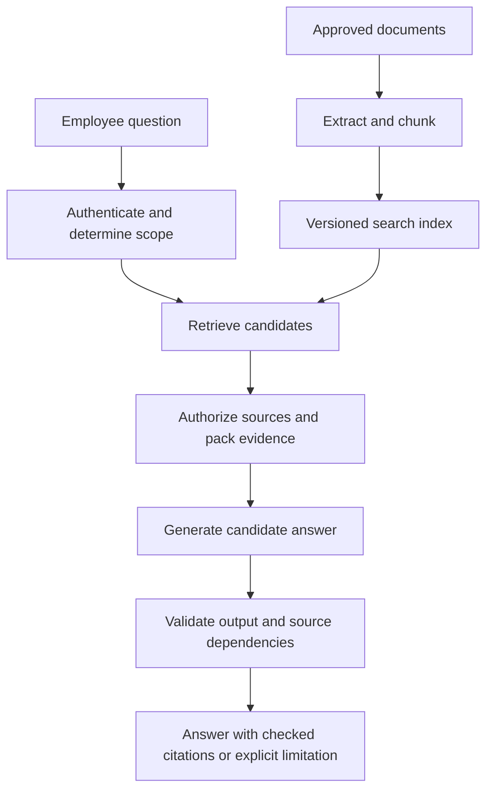

The ExampleCo assistant can explain a policy when an engineer manually pastes the right paragraph. That is a useful prototype, but employees ask about hundreds of documents. The engineer cannot select every excerpt by hand.

**Retrieval-augmented generation (RAG) automates evidence selection: find relevant source material, put it into the request, and ask the model to answer from it.** Think of it as an open-book exam, not as teaching the model new facts permanently.

## What Changes From a Direct Model Call?

| Direct generation | RAG |
|-------------------|-----|
| Question goes straight to the model | Search selects evidence before generation |
| Model relies on supplied context and learned patterns | Model also receives retrieved passages |
| No automatic connection to current private documents | Application can retrieve current permitted documents |
| Hard to trace a company-specific claim | Source IDs can connect claims to evidence |

RAG does not require vectors. Keyword search, structured database queries, and mixed retrieval can all supply evidence.

## Two Paths, Not One

### Ingestion: Prepare Evidence Ahead of Time

1. Load approved documents.
2. Extract usable text.
3. Split text into searchable passages.
4. Store source locations, versions, and permission references.
5. Build keyword and/or vector indexes.

### Request: Answer One Question

1. Authenticate the caller.
2. Establish the caller's tenant and applicable employee facts.
3. Retrieve relevant, permitted passages.
4. Fit selected evidence into the model's context budget.
5. Generate a candidate answer.
6. Validate the output and resolve citations.
7. Recheck source eligibility before returning sensitive results.



Retrieved text must not enter an external reranker or generator until it is authorized. An index's copied permission metadata is an optimization, not necessarily the final authority.

## Build It in Three Understandable Versions

### Version 1: No Evidence

```text
Question -> Model -> "You receive 25 days"
```

The problem is not the sentence's style. The model was never given ExampleCo's rule.

### Version 2: Manually Selected Evidence

```text
Question + leave-policy-v3 section 2 -> Model -> "20 days [source]"
```

This proves that supplying the right passage helps. It also provides a baseline for distinguishing a retrieval failure from a generation failure.

### Version 3: Search-Selected Evidence

```text
Question -> Search permitted policies -> Select section 2
         -> Model -> Validated answer with source reference
```

Only replace the manual step when it is understood. Adding orchestration frameworks first can conceal which component is actually failing.

## A Concrete Request and Response

```text
Verified employee facts:
  region: Region A
  employment_type: full_time

Question:
  What is my annual leave entitlement?

Evidence:
  ID: leave-v3-s2
  Document: Annual Leave Policy, version 3, section 2
  Text: Full-time employees in Region A receive 20 days
        of annual leave per calendar year.
```

Candidate model output:

```json
{
  "status": "answered",
  "answer": "The supplied policy gives full-time Region A employees 20 days of annual leave per calendar year.",
  "source_ids": ["leave-v3-s2"]
}
```

The server turns `leave-v3-s2` into a citation with a document title, version, section, and authorized viewing route. It does not trust a URL invented by the model.

## Grounding Is More Than Adding a Citation

An answer is **grounded** when its claims are supported by the evidence actually supplied.

Four separate questions matter:

1. **Existence:** Is the cited source real?
2. **Eligibility:** Is it current and permitted for this caller?
3. **Support:** Does the cited passage establish the claim?
4. **Coverage:** Are the important claims all supported?

Example:

> "You receive 20 days, can carry all unused days indefinitely, and can cash them out."

The supplied excerpt supports only the annual entitlement. Attaching its citation to the whole sentence does not support the extra promises.


**RAG can retrieve the right passage and still produce a wrong answer.** Retrieval reduces some information gaps; it does not eliminate misinterpretation, prompt injection, or fabricated claims.


## Missing and Conflicting Evidence

| Situation | Better behavior |
|-----------|-----------------|
| Region is missing | Ask which region applies, or use an authorized employee record |
| Only contractor policy is retrieved for a full-time employee | Do not apply it; search again within a bounded policy |
| No permitted source answers the question | State that available evidence is insufficient |
| Old and new policy disagree | Use authoritative active/effective-version rules |
| Two current authorities conflict | Explain the conflict or route for review |
| User asks remaining balance | Use an authorized balance service, or state that policy alone is insufficient |

Do not disclose that a confidential document exists merely to explain why it could not be retrieved.

## An Explicit Orchestration Skeleton

```text
PSEUDOCODE
identity = authenticate(request)
question = validate_question(request.question)
facts = load_authorized_applicability_facts(identity)

candidates = search_with_scope(identity.tenant, question, facts)
sources = authorize_and_load_current_sources(identity, candidates)
evidence = select_relevant_evidence_within_budget(question, sources)

if evidence is empty:
    return unsupported("The available policy evidence does not answer this question")

response = generate(question, facts, evidence, response_schema)
require_successful_completion(response)
answer = validate_schema_and_status(response)
require_citations_from_supplied_evidence(answer, evidence)
apply_evaluated_claim_support_policy(answer, evidence)

if source_permissions_or_versions_changed(identity, evidence):
    discard_answer_and_report_retryable_source_change()

return render_with_server_resolved_citations(answer)
```

This is pseudocode, not a complete security implementation. In particular, "relevant evidence" and "claim support" need measured behavior, not an unexplained confidence threshold.

## Diagnose the Right Failure

Use the manually selected correct passage as a debugging tool.

| Experiment | Observation | Likely direction |
|------------|-------------|------------------|
| Normal retrieval | Correct passage absent | Ingestion, filtering, indexing, or ranking problem |
| Manually provide correct passage | Answer still wrong | Prompt, model, interpretation, or output issue |
| Correct answer with manual passage | Wrong answer with retrieved context | Missing evidence, distracting context, or conflict |
| Correct answer, wrong citation | Source selection or output validation issue | Fix citation handling separately |

A more expensive model is not a direct fix for a document that was never indexed.

## Evaluate the Whole Evidence Chain

Test:

- Supported questions with different entitlement numbers.
- Paraphrases such as "holiday allowance."
- Questions requiring an exception and a main rule.
- Missing applicability information.
- Unanswerable questions.
- Policy updates, deletion, and access revocation.
- Malicious instructions embedded in a source.
- Provider timeout and incomplete output.

Measure evidence retrieval and answer quality separately. See [evaluation and observability]({}).

## Related Concepts

- [Embeddings]({}) and [full-text search]({}) provide retrieval options.
- [RAG ingestion and retrieval]({}) covers evidence preparation and updates.
- [Prompt design]({}) defines the response contract.

## Trade-offs

| Approach | Benefit | Limitation |
|----------|---------|------------|
| Direct model call | Smallest architecture | No automatic current company evidence |
| Manually supplied evidence | Clear learning and debugging baseline | Does not scale selection |
| Search-based RAG | Current, traceable evidence at request time | Search and lifecycle complexity |
| Whole-document context | Avoids passage selection for some tasks | Context size, distraction, and cost |
| Structured lookup without generation | Exact values and predictable output | Less flexible explanation |

## Test Your Understanding


Ordinary RAG does not. It supplies retrieved text during inference. Changing the indexed policy can change future answers without training the answer model.



The model can misinterpret conditions, combine conflicting passages, add unsupported claims, or ignore evidence. Evaluate generation and validate outputs independently of retrieval.



No. Keyword search, structured queries, or manual selection can provide evidence. The architectural idea is retrieval before generation, not a particular storage product.



It isolates generation quality. If the model fails even with the correct excerpt, changing search settings is not the immediate solution.



Not yet. The passage must support the specific claims, and the answer must not add unsupported details. Existence and access are necessary but insufficient.



No. Annual entitlement and remaining balance differ. The latter requires account-specific records and applicable calculations.



Apply a documented authority rule if one exists. Otherwise surface the conflict or route for review instead of inventing a compromise.



Additional documents can introduce stale rules, contradictory regions, irrelevant details, and more opportunities for unsupported synthesis. Optimize evidence coverage, not raw context volume.



That may disclose confidential document existence. Return an appropriately generic evidence limitation unless the product explicitly authorizes that disclosure.



A reranker also processes source text. Sending forbidden text there is already an exposure, even if the final generator never receives it.



No. Similarity indicates relatedness, not sufficient evidence. A highly similar passage can omit the needed exception or refer to a different employee group.



Revalidate the selected source versions and permissions before returning the answer. If they changed, discard or retry under a bounded policy instead of presenting stale evidence as current.



It may invent paths or point to unintended destinations. Have it select allowed source IDs and resolve them through server-owned, access-checked metadata.



The retrieval path may still omit or dilute the required evidence. Inspect extraction, filters, ranking, and packed context rather than continuing to upgrade the generator.



No. Empty evidence is a domain limitation or retrieval condition. A provider outage is an operational failure. Report and monitor them separately.



An answer cache, conversation history, or source snapshot may still contain the old content. Freshness must cover the entire evidence and response lifecycle.



Only if it actually establishes every material claim. A citation for entitlement does not also prove carryover, cash-out, and approval rules.



A lost table header or dropped negation can change the evidence before retrieval begins. The generator cannot reliably recover the original meaning from corrupted text.



No. It can discard irrelevant evidence and answer from sufficient relevant sources. But it should not use unrelated text to fill gaps or treat candidate retrieval as proof.



Answers must use current, permitted, applicable evidence, with explicit behavior when that cannot be established. Fluent generation is downstream of that invariant, not a substitute for it.

