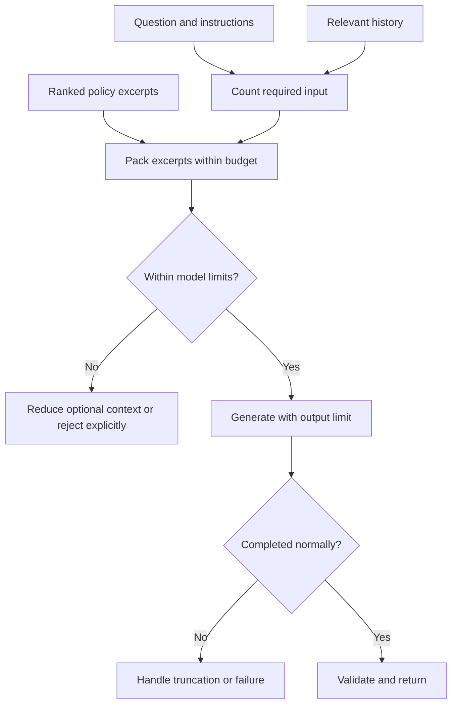

The first ExampleCo demo works with one paragraph. Then someone uploads a 200-page policy handbook and pastes a month of chat history into the same request. The provider rejects it for exceeding the input limit. You shorten the answer limit, retry, and now the assistant stops halfway through a sentence.

**Input space, output space, and randomness are separate controls.** Treating them as one "model size" setting makes both correctness and cost difficult to reason about.

## Tokens Are the Model's Text Units

A **tokenizer** converts text into numerical IDs. Tokens can represent words, parts of words, punctuation, or other text fragments.

```text
Illustrative only, not a specific tokenizer's output:
"annual entitlement" -> ["annual", " ent", "itlement"]
```

Do not build limits from that illustration. Different models tokenize the same sentence differently. Code, tables, unusual identifiers, and different languages can have very different token-to-character ratios.

| Quantity | Measures | Useful for |
|----------|----------|------------|
| Characters | Text symbols | UI limits and text processing |
| Bytes | Encoded storage size | Upload and network limits |
| Tokens | Model-specific text units | Model input limits and text usage |
| Words | Human writing units | Editorial guidance, not exact budgeting |

Use the provider's counting method or a compatible tokenizer. Include message wrappers, tool definitions, and any model-specific overhead where required.

## A Context Window Is a Request Budget

The **context window** bounds how much information a model can process in one request. Input limits, maximum output limits, and treatment of reasoning tokens vary by model and API.

A useful planning rule, when the model uses a shared input/output window, is:

```text
instructions + question + history + references + tool material
+ reserved output + safety margin <= context window
```

Also enforce the model's independent input and output limits. A large advertised context window does not imply that the same number of output tokens can be generated.

### Worked Example

Assume a fictional shared window of **16,000 tokens**, a maximum output budget of **2,000 tokens**, and no hidden accounting beyond the stated components.

| Component | Tokens |
|-----------|--------|
| Application instructions | 800 |
| User question | 100 |
| Selected chat history | 2,100 |
| Tool schemas and message overhead | 500 |
| Reserved output | 2,000 |
| Safety margin | 500 |
| **Subtotal before policy excerpts** | **6,000** |
| **Space left for policy excerpts** | **16,000 - 6,000 = 10,000** |

If each selected passage is approximately 500 tokens including its source label, at most **20 such passages fit by size**. That is a ceiling, not a recommendation: three relevant passages may answer better than twenty repetitive ones.

## Build the Request Deliberately



**Do not solve overflow by blindly removing the beginning of the prompt.** That can remove the task, safety instructions, employee clarification, or the policy's applicability conditions.

```text
PSEUDOCODE
available = window - output_reserve - margin - count(required_messages)
if available < 0:
    fail("Required input exceeds the supported request size")

selected = []
for passage in relevance_order:
    candidate = selected + [passage]
    if count(serialize(required_messages, candidate)) <= window - output_reserve - margin:
        selected = candidate

response = generate(required_messages, selected, max_output=output_reserve)
if response.finish_reason != "completed":
    surface_incomplete_or_failed_response(response.finish_reason)
else:
    validate_and_return(response)
```

The names are illustrative. Map actual provider stop, refusal, error, and token-limit statuses explicitly; do not assume every API uses `completed`.

## Conversation History Is Application State

The model does not automatically remember earlier requests. An application may replay prior messages, summarize them, retrieve selected turns, or use a provider-managed conversation feature with its own limits.

| Strategy | Advantage | Risk |
|----------|-----------|------|
| Replay all turns | Preserves exact earlier wording | Eventually exceeds limits and repeats stale data |
| Keep recent turns | Simple and bounded | Loses an important early clarification |
| Summarize older turns | Reduces size | Summary can omit or invent details |
| Retrieve relevant history | Scales to long conversations | Retrieval may miss the needed turn |
| Store structured user facts | Keeps verified fields explicit | Requires source, expiry, consent, and updates |

For the policy assistant, verified `region=Region A` and `employment_type=full_time` are more useful than repeatedly sending an unrelated conversation. Do not let a generated summary silently override an authoritative employee record.

## Output Limits and Truncation

An output limit controls the maximum generated output under the API's accounting rules. It is not a guarantee that the answer will fit.

When the limit is reached:

1. Detect the provider's incomplete/token-limit status.
2. Do not parse a partial object as a complete answer.
3. Decide whether to retry once with a shorter requested format or an increased approved budget.
4. Report failure if the bounded recovery does not work.

A streamed partial answer should be visibly provisional. Do not commit partial generated arguments as a real business action.

## Temperature and Top-p

At each step, the model has a distribution over candidate tokens.

- **Temperature** reshapes that distribution. Lower values generally favor high-probability choices; higher values allow more variety. Exact support and behavior depend on the API.
- **Top-p**, or nucleus sampling, keeps a set of candidate tokens whose cumulative probability reaches a chosen threshold, then samples within that set.

Suppose the next-token probabilities are:

| Candidate | Probability |
|-----------|-------------|
| `20` | 0.60 |
| `25` | 0.25 |
| `30` | 0.10 |
| Other | 0.05 |

With top-p set to 0.80, a typical implementation keeps `20` and `25`, since their cumulative probability is 0.85. It does **not** mean "the answer is 80% accurate."


**Less random is not more informed.** If the most likely answer is wrong, greedy decoding can repeat that wrong answer consistently. Temperature zero also does not guarantee identical outputs across hardware, implementations, or provider changes.


Change one sampling setting at a time during experiments. Compare actual task performance rather than choosing an impressive-sounding value.

## Bigger Context Is Not Automatically Better

More context can increase:

- Input processing latency and cost.
- Distracting or conflicting passages.
- Exposure of unnecessary sensitive information.
- Difficulty tracking which source supports which claim.

Long-context models can be valuable, especially for document-wide tasks. Retrieval is still useful for relevance, permissions, freshness, and cost. Choose by measured task quality, not window size alone.

## Related Concepts

- [LLM fundamentals]({}) explains the generation loop.
- [RAG ingestion and retrieval]({}) explains passage selection.
- [Serving, latency, and cost]({}) connects tokens to operational budgets.

## Trade-offs

| Choice | Helps | Costs or risks |
|--------|-------|----------------|
| More input context | Broader available evidence | More latency, cost, and distraction |
| Larger output reserve | Longer answers can complete | Less room for input and potentially more spend |
| History summarization | Longer conversations fit | Lossy, potentially incorrect state |
| Low-randomness decoding | More stable phrasing | Can stably repeat unsupported claims |
| Higher-randomness decoding | More varied drafting | Less suitable for tightly constrained answers |

## Test Your Understanding


Not under the shared-window assumption: 15,000 + 2,000 exceeds 16,000 even before a safety margin. Reduce input or output, or use a suitable model. Also check independent API limits and model-specific accounting.



The limit is measured in tokens, not words, and the full request includes instructions, history, schemas, wrappers, and possibly other material. Count the serialized request using the correct tokenizer and rules.



No. It controls candidate-token selection using cumulative next-token probability. It neither evaluates sources nor calibrates the truth of the completed answer.



It favors the highest-scoring continuation, not a verified fact. If the input lacks the policy and the model favors 25 days, reducing randomness can make the unsupported answer more repeatable.



No. Fitting is a capacity check. Relevance, placement, conflicting information, and generation quality still affect behavior. Test whether the answer actually uses and correctly interprets the evidence.



That message may establish that the employee is a contractor or works in another region. Age is not the same as irrelevance. Preserve verified applicability facts separately from disposable chat.



Not automatically. Summaries are lossy generated artifacts and can omit exceptions or invent details. Keep authoritative policy references and retrieve current evidence rather than treating a summary as policy.



Syntactic repair cannot recover missing semantic content. The omitted fields may include citations or an unsupported-answer status. Detect truncation and use a bounded regeneration policy instead of manufacturing completion.



Otherwise input can consume space needed to finish the answer. Packing should consider the total supported request budget, not just how much input the provider accepts.



Only if it is actually compatible with each model and its message accounting, which should not be assumed. Different tokenization and overhead can make the same estimate inaccurate.



Fail explicitly or redesign the request. Do not silently drop mandatory instructions, authorization constraints, or required schema definitions just to make the provider accept it.



Not necessarily. Models often have separate maximum output limits and model-specific constraints. Context capacity and generation capacity must be checked independently.



No. Streaming changes delivery timing, not the generation budget. A streamed response can still be truncated and must report completion or failure explicitly.



A higher limit allows more generation but does not force every response to use it. Actual spend depends on generated tokens and the task. Measure output distributions and cost per successful task.



They may be repetitive, stale, contradictory, or unnecessary. Size is an upper bound; relevance and evidence coverage determine usefulness. A smaller set can be cheaper and more accurate.



No. Model versions, backend implementations, hardware, parallel computations, and unsupported seed guarantees can affect reproducibility. Record versions and test tolerated behavior rather than requiring identical prose.



No. Sampling cannot introduce authoritative missing evidence. Retrieve the applicable policy or state that the current evidence does not answer the question.



The serialized request size matters. Source IDs, headings, separators, and formatting consume space too. Count what the model actually receives, not just the raw passage.



They measure different resources. Passing a network or storage size limit does not imply that the parsed text, instructions, and output reserve fit the model's context.



Mark the response incomplete rather than treating plausibility as completion. Preserve a clear retry or recovery path and avoid acting on unvalidated partial structured output.

