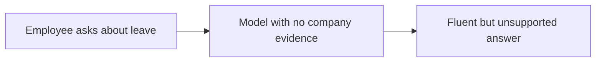
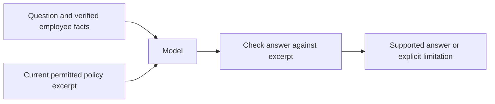
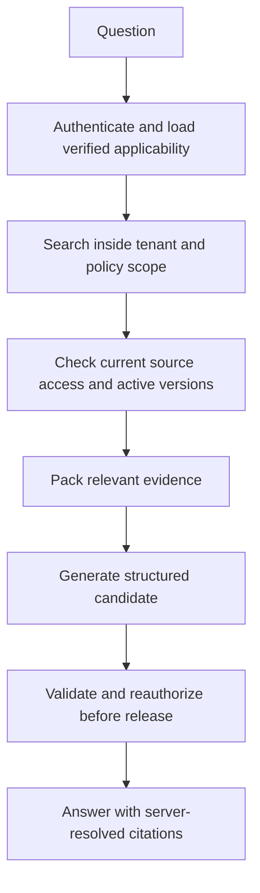
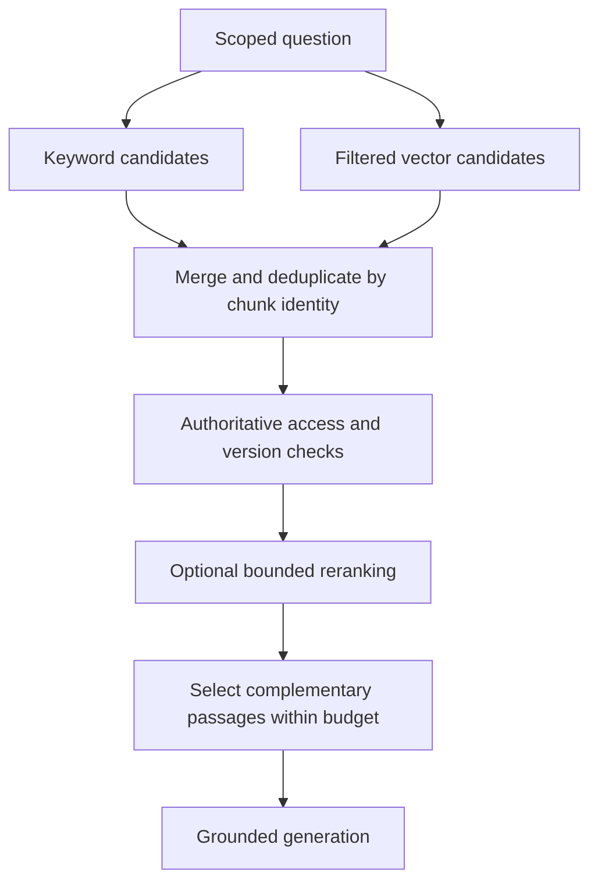
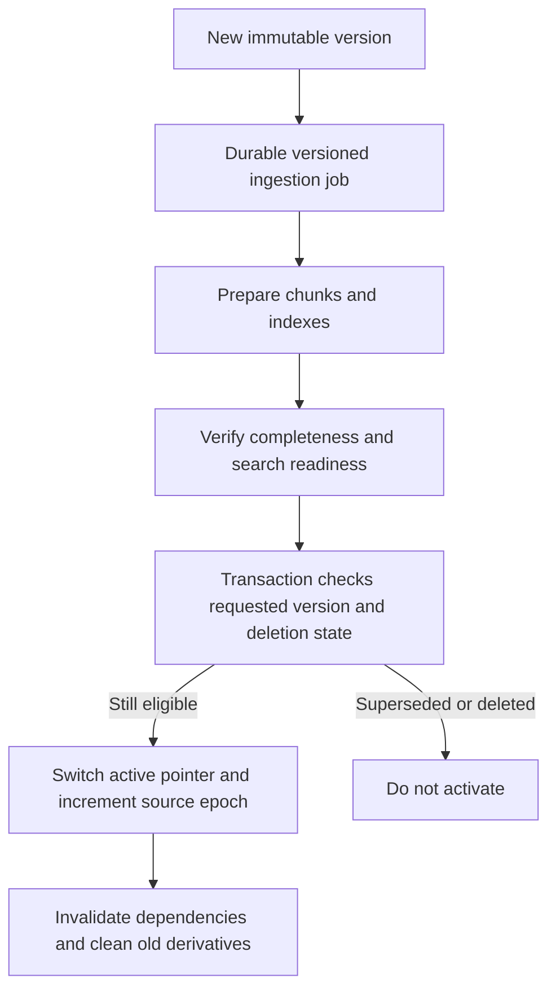
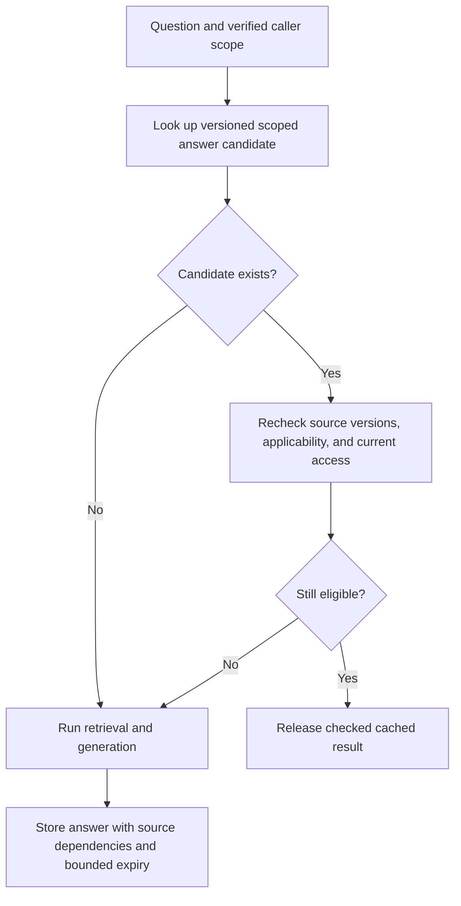
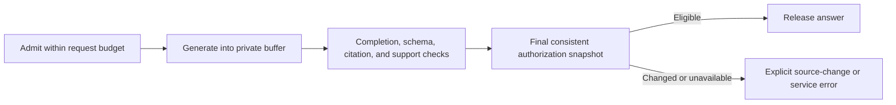
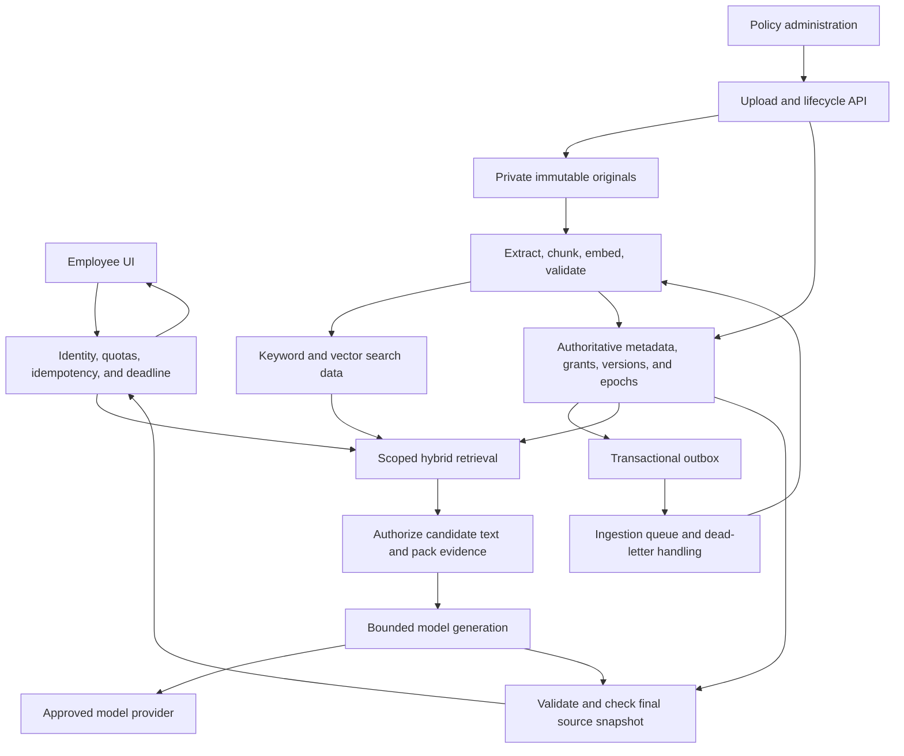

## Refinement 1: Replace Guessing With Evidence

### Problem

A direct model call has no automatic access to ExampleCo's current policy.



### Modification

First supply a manually chosen, permitted excerpt:



This is the smallest useful baseline. If the model still misreads the right policy, adding a search engine will not fix that interpretation error.

### Justification and Trade-offs

Manual evidence makes generation behavior testable. It does not scale document selection. Preserve this baseline in evaluation as an "oracle evidence" experiment, then automate only the selection step.

## Refinement 2: Automate Scoped Retrieval

### Problem

Employees ask many kinds of questions. Manual excerpt selection is no longer practical, and policies apply to different employee groups.

### Modification



Use the existing response contract from [prompt design]({}). The model selects source IDs, not arbitrary URLs.

### Justification and Trade-offs

This adds a retrieval failure mode, but makes evidence selection scalable and source-backed. A user's question may supply a clarification, but must not overwrite authoritative identity or grant new document access.

For version one:

- Use keyword retrieval and an exact vector baseline over an eligible set.
- Load current permissions before passing text to downstream processors.
- Omit agent planning and write tools.
- Return `unsupported` only for an actual evidence limitation, not an infrastructure outage.

## Refinement 3: Improve Recall Without Weakening Filters

### Problem

Exact vector scans become expensive at peak traffic. Semantic retrieval also misses exact policy IDs, while keyword search misses paraphrases.

### Modification



Add a vector index only after measuring the exact baseline. Tune search effort against exact-neighbor recall and separately measure labeled-evidence recall.

An illustrative candidate plan:

```text
Keyword top 50 + vector top 50
-> deduplicate
-> reject ineligible source IDs before loading text downstream
-> rerank at most 60 permitted candidates
-> select up to 5 useful passages, subject to token budget
```

If filters leave too few candidates, increase search effort within a bounded policy or use exact search over a small eligible set. **Never drop the tenant or permission filter to improve recall.**

### Justification and Trade-offs

Hybrid retrieval handles exact and semantic queries. Reranking can improve ordering but adds latency and another processor receiving evidence.

Approximate filtering behavior is engine-specific. Benchmark actual tenant selectivity and skew; an unfiltered ANN benchmark is not sufficient.

## Refinement 4: Make Publication and Retirement Explicit

### Problem

Updating chunks in place can expose a mixture of old and new rules. A delayed worker can resurrect a deleted source or replace a newer policy.

### Modification



The database transaction controls **eligibility**, not an impossible atomic transaction across every external processor.

### Justification and Trade-offs

Immutable versions need more storage, but readers can select one complete version. Store the original version's content hash, preparation configuration, and source locations.

For a deletion:

1. Tombstone the document and increment the source epoch in the authoritative transaction.
2. Block source viewing, retrieval use, and response-cache reuse.
3. Enqueue cleanup of originals and derived records under the retention policy.
4. Ensure late jobs see the tombstone and cannot activate.

For permission changes, update grants/membership state and the authorization epoch transactionally. Do not rely on a queued index update for immediate authorization decisions.

## Refinement 5: Cache Only With Evidence Dependencies

### Problem

Popular policy questions repeat. A cache could save model calls, but a question-only key would reuse answers across regions, tenants, or permission changes.

### Modification



Use exact normalized-question matching initially. Semantic reuse adds a separate risk: two similar questions can ask about entitlement and remaining balance.

### Justification and Trade-offs

A safe cache can lower cost and latency, but dependency checks remain on the hit path. Coarse tenant epochs simplify invalidation at the cost of discarding answers after unrelated policy changes.

Version one can omit answer caching entirely. Add it only if measured savings justify these lifecycle checks.

Idempotency replay is also reuse: a previously completed question response must not bypass current source eligibility just because its request key matches.

## Refinement 6: Protect the Release Boundary and the Deadline

### Problem

A source can change during generation. Immediate token streaming would expose text before final source and answer checks.

### Modification



All work shares a 12-second deadline and at most two model attempts, including any schema-repair attempt. A retry is permitted only when the error is eligible and enough time and budget remain.

### Justification and Trade-offs

Buffering costs perceived responsiveness, but supports the final check. The UI can show safe progress events without streaming answer content.

The final transaction is the release authorization point. It cannot revoke bytes already sent, and a response authorized before a concurrent revocation can still be in flight.

## Final Consolidated Architecture



The search data can initially be tables and indexes in the same PostgreSQL deployment. Drawing a separate box describes a responsibility, not a requirement for a new service.

## API Drill-Down

### Upload and Replacement

`POST /api/v1/documents` accepts supported file content and metadata such as title and policy applicability. Permissions are established by the authorized administration flow, not inferred from document text.

```json
{
  "document_id": "doc-leave",
  "version": 3,
  "job_id": "job-31",
  "state": "uploaded"
}
```

This is a `202` response. The job resource later reports `processing`, `ready`, `failed`, or `superseded`, with a safe error code when needed. Activation state is recorded on the logical document.

Replacement and permission updates use an expected document revision, such as `If-Match`, to reject conflicting administrative changes. A version number by itself is not a concurrency lock.

### Question Processing

- Require a nonempty question within the documented input size.
- Resolve conversation ownership before reading any history.
- Load verified applicability facts separately from generated summaries.
- Recheck source-derived prior turns before including them.
- Do not allow arbitrary source text or tenant identity to replace the application-owned evidence channel.

The response schema has `answered`, `needs_clarification`, or `unsupported`. Transport/provider/authorization failures remain explicit API errors.

### Citation Viewing

`GET /api/v1/sources/{source_id}`:

1. Resolves the identifier inside the caller's tenant.
2. Checks current access and eligible version.
3. Loads the exact source location.
4. Returns controlled content or a consistent unavailable response.

Do not expose a long-lived object-store URL that continues working after application-level access is revoked.

## Database Schema and Indexes

The following is a logical schema; field types and migration syntax depend on the chosen implementation.

```text
documents
  PRIMARY KEY (tenant_id, document_id)
  requested_version_id, active_version_id
  deleted_at, row_revision, acl_revision

document_versions
  PRIMARY KEY (tenant_id, document_id, version_id)
  object_key, content_hash, state
  chunker_version, embedding_version, expected_chunk_count

chunks
  PRIMARY KEY (tenant_id, chunk_id)
  FOREIGN KEY (tenant_id, document_id, version_id)
  UNIQUE (tenant_id, document_id, version_id, chunker_version, ordinal)
  text, section, page, embedding, embedding_version

document_grants
  PRIMARY KEY (tenant_id, document_id, principal_id, permission)

memberships
  PRIMARY KEY (tenant_id, user_id, group_id)

tenant_state
  PRIMARY KEY (tenant_id)
  source_epoch, authorization_epoch
```

Current group membership participates in authorization. Stale group claims in a long-lived token cannot establish immediate revocation semantics on their own.

Useful indexes:

- B-tree on chunk `(tenant_id, document_id, version_id)` for version retrieval and cleanup.
- Full-text index for policy phrases and identifiers.
- Compatible vector index for the selected embedding space when measured scale requires it.
- Grant/membership indexes supporting tenant-scoped permission joins.
- Expiry indexes for conversation and idempotency-record cleanup.

Do not mix incompatible embedding versions in a query. An embedding migration prepares a parallel representation and switches the query encoder/index configuration together.

### Conversation and Request State

```text
conversations
  PRIMARY KEY (tenant_id, conversation_id)
  owner_id, created_at, expires_at

turns
  PRIMARY KEY (tenant_id, conversation_id, turn_id)
  encrypted_content, source_dependencies, created_at

requests
  UNIQUE (tenant_id, caller_id, endpoint, idempotency_key)
  request_hash, state, lease_expiry, provider_request_id
  result_reference, source_dependencies, expires_at
```

A worker taking over an expired request lease must consider an uncertain prior provider call. If the provider cannot reconcile it, bounded duplicate inference cost may be unavoidable; application idempotency is not a claim of exactly-once billing.

## Core Answer Algorithm

```text
PSEUDOCODE
identity = authenticate(request)
deadline = now + 12 seconds
request_state = reserve_or_load_idempotent_request(identity, request)
validate_body_hash_and_ownership(request_state)

if request_state.completed:
    revalidate_response_dependencies_or_return_source_changed(request_state)
    return stored_result

facts = load_current_authorized_employee_facts(identity)
history = load_owned_unexpired_history(request.conversation_id)
history = exclude_ineligible_source_derived_content(history, identity)

snapshot = read_authoritative_source_and_permission_state(identity)
candidates = hybrid_search(question, snapshot.tenant, facts)
evidence = authorize_load_and_select(candidates, snapshot, identity)

if evidence cannot answer because applicability is missing:
    return needs_clarification_with_specific_question()
if evidence is insufficient:
    return unsupported_without_disclosing_hidden_sources()

prompt = pack(question, facts, history, evidence)
require_serialized_input_at_most(6000_tokens)
response = generate_with_total_attempt_limit(2, deadline, max_output=600_tokens)
require_complete_nonrefusal_response(response)
answer = validate_schema_status_and_supplied_citations(response)
apply_evaluated_claim_support_policy(answer, evidence)

transaction using one current authorization snapshot:
    require_sources_still_active_and_permitted(identity, evidence)
    require_compatible_source_and_authorization_epochs(snapshot)
    persist_completed_result_and_dependencies(request_state, answer)

return server_rendered_answer_and_citations(answer)
```

Domain outcomes such as `unsupported` also need durable request completion if idempotency replay is supported. Provider or infrastructure errors must record failed/uncertain state, not completed success.

### Token Budget

Use a model supporting the chosen limits, with provider-specific accounting verified:

```text
Maximum serialized input: 6,000 tokens
Maximum generated output: 600 tokens
Safety margin:            400 tokens
Total planned envelope: 7,000 tokens
```

A nominal 8,000-token shared window leaves additional room under this simplified assumption. Separate input/output limits or reasoning-token accounting can change the required configuration.

The 2,000-input-token estimate in capacity planning is an **average**, not this hard maximum. Longer evidence-heavy questions cost more.

If required input exceeds the budget, remove optional history or redundant passages. Do not truncate policy conditions or mandatory instructions blindly.

### Claim Support Is Not a Magical Validator

For the narrow entitlement example, structured applicability and numerical checks can catch known errors. General policy explanations require reviewed evaluation and possibly additional verification.

No schema or secondary model proves arbitrary natural-language entailment perfectly. Document the residual quality risk and route high-impact unresolved cases to the policy owner.

## Edge Cases and Failure Handling

| Edge case | Required behavior |
|-----------|-------------------|
| Upload retry | Same versioned job; no duplicate chunks |
| Old worker completes late | Activation rejected as superseded |
| Search returns retired version | Reject before downstream text use |
| Source changes during generation | Discard answer; return `409 source_changed` or bounded safe retry |
| Authorization cannot be checked | Fail closed with an operational error |
| Provider returns partial JSON | Bounded recovery or explicit invalid-output failure |
| Provider times out | Respect remaining deadline and retry budget |
| Conversation belongs to another employee | Deny before reading any turns |
| Prior answer cites a deleted source | Do not reuse it as current evidence |
| User asks remaining balance | Clarify scope or state missing account data |
| Cache contains forbidden source | Reject reuse and invalidate |
| Evaluation finds unsupported synthesis | Fix prompt/evidence/model behavior; do not hide with a citation |
