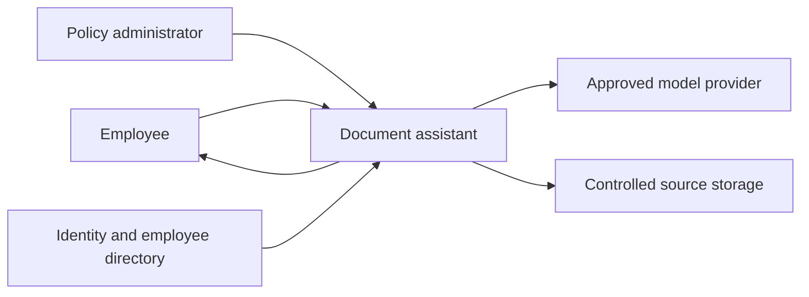
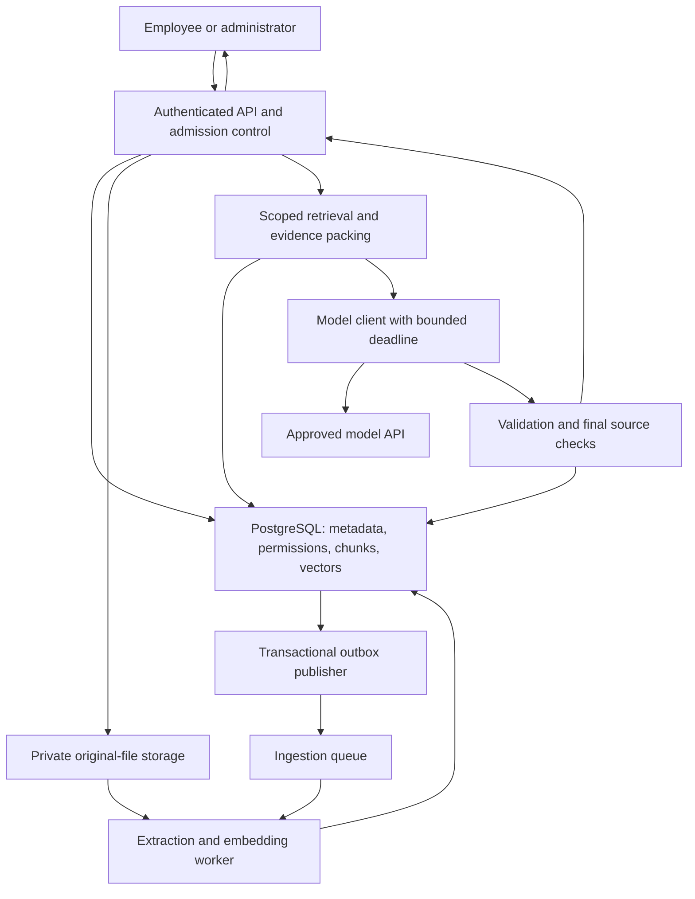

## Capacity Estimation

Use the [requirements]({}) as assumptions, then show the arithmetic. Decimal units are used below: 1 KB = 1,000 bytes and 1 GB = 1 billion bytes.

### Traffic

| Metric | Calculation | Result |
|--------|-------------|--------|
| Questions/day | 20,000 active users * 10 | 200,000 |
| Average question rate | 200,000 / 86,400 s | 2.31 questions/s |
| Peak estimate | 2.31 * 12 business-hour/burst factor | 27.8 questions/s |
| Initial peak target | Round 27.8 upward | 30 questions/s |
| Ingestion jobs/day | 1,000 new + 500 replacement documents | 1,500 |
| Average ingestion rate | 1,500 / 86,400 s | 0.0174 documents/s |
| Illustrative ingestion burst | 0.0174 * 20 | 0.35 documents/s |

The burst factors are assumptions to replace with observed traffic. Ingestion and interactive questions need separate quotas so a large upload batch cannot consume every model or embedding slot.

### Corpus and Storage

Assume 50 chunks/document, a 768-dimensional float32 embedding, average chunk text of 2 KB, and 500 bytes of per-chunk metadata.

| Item | Calculation | Active-corpus size |
|------|-------------|-------------------|
| Chunks | 100,000 * 50 | 5 million |
| Raw vectors | 5M * 768 * 4 B | 15.36 GB |
| Chunk text | 5M * 2,000 B | 10 GB |
| Chunk metadata | 5M * 500 B | 2.5 GB |
| **Chunk/vector subtotal** | 15.36 + 10 + 2.5 | **27.86 GB** |
| Original files | 100,000 * 1 MB average | 100 GB |

Plan for approximately two retained prepared versions per document in this estimate:

```text
Prepared logical data: 27.86 GB * 2 = 55.72 GB
Three database copies: 55.72 GB * 3 = 167.16 GB
```

This **excludes** ANN graph/index overhead, database page overhead, write-ahead logs, backups, temporary rebuild space, and document-level ACL tables. Measure those before buying capacity.

The original-file estimate becomes approximately 200 GB for two retained versions, before the object store's own replication/billing rules.

### Conversation Data

Assume each question/answer pair occupies 2 KB after storage encoding:

```text
200,000 pairs/day * 2 KB * 7 days = 2.8 GB logical content
```

Add indexes, encryption/storage overhead, and replicas separately. Conversation content is not the same as safe operational logs.

### Memory and Initial Database Shape

If 25% of active chunks are the hot set:

```text
Hot vectors: 15.36 GB * 0.25 = 3.84 GB
Hot text:       10 GB * 0.25 = 2.50 GB
Hot metadata:  2.5 GB * 0.25 = 0.625 GB
Subtotal:                       6.965 GB
```

That is not a full memory requirement: indexes, other working data, query concurrency, and database buffers add more.

Start by testing a PostgreSQL deployment with vector support, a primary plus standby and read copy, and a memory/storage envelope sized with measured index overhead. **Do not shard five million vectors automatically.** Partitioning or a separate search service is a later measured decision.

Authoritative version and permission checks go to the primary or an equivalently current authority. A read copy must not decide revocation from stale state.

### Model Capacity

Assume an average request contains 2,000 input tokens and generates 400 output tokens.

| Metric | Calculation | Result |
|--------|-------------|--------|
| Average token volume/day | 200,000 * 2,400 | 480M tokens/day |
| Peak request quota | 30 * 60 | 1,800 requests/minute |
| Average peak token volume | 30 * 60 * 2,400 | 4.32M tokens/minute |
| Admission-cap peak token volume | 30 * 60 * (6,000 + 600) | 11.88M tokens/minute |
| In-flight requests | 30/s * 4 s assumed mean duration | 120 average at peak |

The four-second value is a planning mean at the specified admitted load, not a derivation from p50. Tail latency and provider quota accounting require separate tests.

The 4.32 million tokens/minute figure forecasts typical load and spend. It is not the provider quota. The API admits up to 6,000 input tokens and reserves up to 600 output tokens, so a fully loaded minute is 11.88 million tokens. Buy quota for that admission cap, or lower the cap and reject the oversized question before the model call. Do not truncate mandatory policy text to make an average-sized quota look sufficient. Many providers reserve `max_output` even when generation stops early.

If one asynchronous application instance safely supports 40 in-flight requests in a benchmark, five instances provide 200 slots; losing one leaves 160. This is a starting hypothesis with headroom, not proof that five servers meet the target.

For ingestion:

```text
1,500 documents/day * 50 chunks = 75,000 embeddings/day
75,000 * 400 average tokens/chunk = 30M embedding-input tokens/day
```

Batch ingestion where useful, with its own deadline and provider quota.

### Bandwidth

| Flow | Calculation | Estimate |
|------|-------------|----------|
| Answer egress | 200,000/day * 4 KB | 0.8 GB/day |
| Peak answer egress | 30/s * 4 KB | 120 KB/s |
| Uploaded originals | 1,500/day * 1 MB | 1.5 GB/day |
| Peak text input to model | 30/s * 2,000 tokens * 4 B/token assumption | 240 KB/s |

The byte/token ratio is an illustrative bandwidth assumption, not a token-counting rule. TLS, protocol overhead, citations, and internal duplicate transfers add more.

### Hypothetical Cost

Assume $1/million input tokens, $4/million output tokens, and $0.10/million embedding-input tokens. These are **invented rates**, not vendor prices.

```text
Model cost/request = 2,000/1M * $1 + 400/1M * $4
                   = $0.0036
Model cost/day     = 200,000 * $0.0036 = $720
Embedding/day      = 30M/1M * $0.10 = $3
```

Add retries, invalidated generations, retrieval, any reranking service, storage, network, and operations. Capacity planning should use quota and latency tests as well as a budget.

## API Design

Identity and tenant come from the authenticated session. Clients cannot choose another tenant in the request body.

| Endpoint | Purpose | Important responses |
|----------|---------|---------------------|
| `POST /api/v1/documents` | Upload a new approved document | `202` accepted, `400` invalid, `413` too large, `415` unsupported type |
| `POST /api/v1/documents/{id}/versions` | Prepare a replacement | `202` accepted, `409` revision conflict |
| `GET /api/v1/jobs/{id}` | View authorized ingestion status | `200` with processing state |
| `PATCH /api/v1/documents/{id}/permissions` | Update access under revision control | `200`, `409` revision conflict |
| `DELETE /api/v1/documents/{id}` | Durably tombstone the document and block future use | `204` once the tombstone commits |
| `POST /api/v1/questions` | Ask a scoped policy question | `200` domain result; explicit errors below |
| `GET /api/v1/conversations/{id}` | Read owned, revalidated history | `200` |
| `DELETE /api/v1/conversations/{id}` | Delete retained history | `204` |
| `GET /api/v1/sources/{source_id}` | View access-checked evidence | `200`; consistent `404` for unavailable/forbidden sources |

Return `401` for missing/invalid authentication. Administrative authorization failures follow a consistent non-disclosure policy; do not reveal another tenant's object existence.

Use an `Idempotency-Key` for upload and logical question creation. Store it under tenant, caller, endpoint, and request hash; reuse with a different body returns `409`.

### Example Question

```json
{
  "question": "What is my annual leave entitlement?",
  "conversation_id": "conv-7"
}
```

Successful supported result:

```json
{
  "request_id": "req-42",
  "status": "answered",
  "answer": "The current policy gives full-time Region A employees 20 days of annual leave per calendar year.",
  "sources": [
    {
      "source_id": "leave-v3-s2",
      "title": "Annual Leave Policy",
      "version": 3,
      "section": "2",
      "href": "/api/v1/sources/leave-v3-s2"
    }
  ]
}
```

The application constructs `sources` from checked model-selected IDs. The model does not own titles, URLs, or permissions.

Other `200` domain statuses are `needs_clarification` and `unsupported`, with a clear message and an empty source list under this contract.

| Error | Meaning |
|-------|---------|
| `400 invalid_question` | Empty, oversized, or invalid input |
| `409 source_changed` | Selected source eligibility changed before release |
| `422 provider_refused` | Provider returned a classified safety refusal, not a schema payload |
| `429 tenant_quota_exceeded` | Caller/tenant exceeded a documented quota |
| `502 invalid_model_output` | Completion failed validation after bounded recovery |
| `503 capacity_limited` | Internal admission capacity unavailable |
| `503 authorization_unavailable` | Source permission could not be established |
| `503 model_unavailable` | No approved model path succeeded |
| `504 deadline_exceeded` | Overall request deadline expired |

For retryable limits/failures, include appropriate retry guidance. Do not map operational errors, or a provider safety refusal, into `unsupported`.

`204` on document delete means the tombstone is durable and new questions must not use that document. It does not mean originals, chunks, vectors, and caches are already purged. A retention job must finish that purge before the privacy deadline. Callers who need purge confirmation poll job status. Do not treat `204` as proof the bytes are gone.

## Data Model

Use composite tenant-scoped keys throughout.

| Entity | Important fields | Purpose |
|--------|------------------|---------|
| `documents` | tenant, ID, requested version, active version, deleted state, ACL revision | Authoritative logical source |
| `document_versions` | tenant, document, version, object key, hash, preparation state, chunker/embedding versions | Immutable source and build metadata |
| `chunks` | tenant, document, version, chunk ID, location, text, vector, embedding version | Searchable evidence |
| `document_grants` | tenant, document, principal/group, permission | Current source access |
| `tenant_state` | source epoch, authorization epoch | Coarse invalidation |
| `ingestion_jobs` | tenant, job, version, attempts, state, last safe error | Durable processing |
| `outbox` | event ID, tenant, event type, payload reference | Reliable handoff to queue |
| `conversations` / `turns` | tenant, owner, ID, expiry, content, source dependencies | Short-lived dialogue |
| `requests` | caller, idempotency key, body hash, state, result reference | Retry reconciliation |

Keep the original file in object storage. Do not let a long-lived public object URL bypass the source-view authorization route.

## High-Level Architecture v1

### Level 0: Context



### Level 1: First Complete Design



### Responsibilities and First-Order Decisions

- **API:** Identity, quotas, idempotency, input validation, and response contract.
- **PostgreSQL with vector support:** Shared transactional metadata and an initial keyword/exact-vector retrieval baseline. Avoid a separate metadata synchronization system until needed.
- **Private object storage:** Durable originals, accessed through application-controlled permissions.
- **Outbox and queue:** Decouple accepted uploads from background work without a database/queue dual-write gap.
- **Workers:** Deterministic versioned preparation, bounded retries, and explicit failure states.
- **Retrieval layer:** Current source filtering, ranking, authorization before downstream text use, and context limits.
- **Model client:** No autonomous tools; provider timeouts, retry limits, and usage tracking.
- **Validation/release gate:** Completion, schema, citations, evaluated support checks, and final source eligibility.

Version one deliberately excludes answer caching and a dedicated vector service. Start with a correctness baseline, then refine the actual bottlenecks in the [deep dive]({}).
